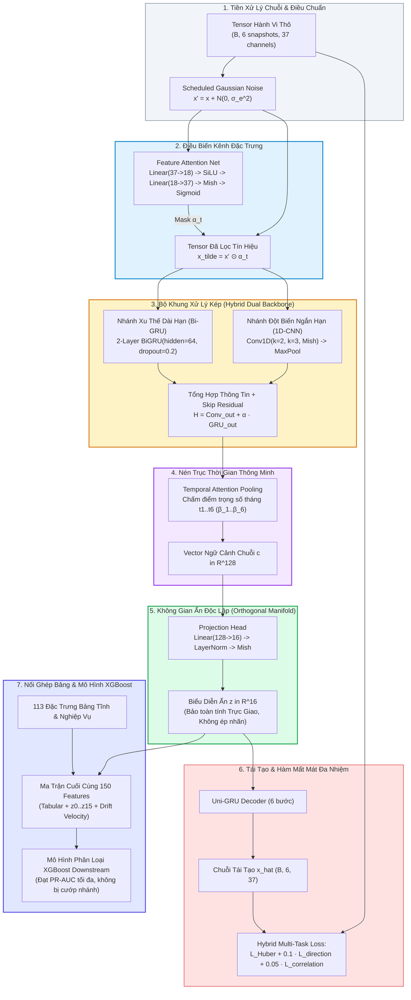

# TÀI LIỆU ĐỊNH HƯỚNG VẬN HÀNH VÀ NÂNG CẤP DEEP LEARNING (DL OPERATIONS)
## KHAI THÁC KỸ THUẬT NÂNG CAO TỪ BÁO CÁO BAREFOOTS (DATA EXPLORERS 2025) CHO DỮ LIỆU CHUỖI HÀNH VI KHÁCH HÀNG

> **Tài liệu Kỹ thuật & Nghiên cứu Kiến trúc (Technical & Architectural Specification)**  
> **Tài liệu tham khảo chính:** [BAREFOOTS.pdf](file:///d:/Introduction%20to%20BA/intro-to-ba/docs/tham%20kh%E1%BA%A3o/BAREFOOTS.pdf) — Báo cáo kỹ thuật đạt giải Cuộc thi Data Explorers 2025 (Chương 3: Mô hình phức hợp LSTM, Attention phân cấp, Multi-Scale Convolutions, Direction Loss).  
> **Áp dụng cho:** Hệ thống Dự đoán Churn Ngân hàng Đa kỳ (Longitudinal Customer Behavioral Modeling).  
> **Tensor đầu vào:** $\mathcal{X} \in \mathbb{R}^{N \times T \times D}$ ($T=6$ snapshots tháng, $D=37$ kênh động học từ Giao dịch, Đăng nhập, Khiếu nại, Tài khoản và Tương tác chéo).

---

## 1. TỔNG QUAN & TÍNH CẤP THIẾT

### 1.1. Hiện Trạng Của Bộ Mã Hóa Chuỗi BiGRU Hiện Tại
Hệ thống hiện tại đang sử dụng kiến trúc `BiGRUTemporalAutoencoder` tự giám sát (`unsupervised`) làm nền tảng trích xuất biểu diễn:
- **Đầu vào**: Tensor $(B, 6, 37)$ chứa 37 kênh động học chuẩn hóa qua 6 tháng.
- **Cấu trúc**: 2 lớp Bi-GRU với $H=64$, chiếu qua `LayerNorm` và `Tanh` để thu hẹp về nút cổ chai ẩn $z \in \mathbb{R}^{16}$.
- **Hàm mất mát**: Mean Squared Error (MSE) Euclidean thuần túy trên toàn bộ ma trận tái tạo.
- **Kết quả thực nghiệm**: Chiến lược `unsupervised` hiện là **baseline mạnh nhất** với PR-AUC đạt **`0.6843`** và ROC-AUC **`0.8674`**. Trong khi đó, việc cố ép các hàm loss có giám sát nhãn trực tiếp (như Asymmetric ArcFace: PR `0.5617`, Hyperbolic Poincaré: PR `0.5348`) đã thất bại vì hiện tượng **"Ăn thịt đặc trưng" (Split Hijacking)** và phá vỡ cấu trúc không gian hình học.

### 1.2. Những Hạn Chế Cốt Lõi Cần Giải Quyết Bằng Deep Learning Hiện Đại
Dù đạt PR-AUC cao, kiến trúc BiGRU cơ bản vẫn tồn tại 4 điểm nghẽn kỹ thuật:
1. **Đối xử cào bằng giữa 37 kênh đặc trưng (Uniform Channel Weighting)**:
   Mô hình gán trọng số ngang nhau cho cả 37 kênh. Trong thực tế, các kênh như `login_count_momentum`, `unresolved_complaints_rate`, hay `tx_net_flow_log` mang tín hiệu báo động churn sớm gấp nhiều lần các kênh có độ nhiễu cao (ví dụ tỷ lệ đăng nhập theo hệ điều hành `login_device_switch_count`).
2. **Bỏ sót các cú sốc hành vi ngắn hạn (Lack of Multi-Scale Resolution)**:
   Mạng RNN/GRU xử lý tuần tự qua từng bước thời gian $t_1 \to t_6$, rất tốt để học xu thế tích lũy dài hạn nhưng kém nhạy bén trong việc bắt các **mô thức đột biến vi mô (micro-motifs / sudden burstiness)** diễn ra trong 2-3 tháng liền kề (ví dụ: đột ngột ngừng rút tiền và rút sạch số dư trong tháng 4-5).
3. **Độ nhạy cảm với ngoại lai của hàm mất mát MSE**:
   Hàm MSE bình phương sai số $\|x - \hat{x}\|_2^2$, khiến gradient của BiGRU bị chi phối bởi các giao dịch đột biến có giá trị lớn (whales / outlier ticket sizes), làm mờ nhạt các biến động tinh tế ở các kênh tần suất.
4. **Thiếu vắng ràng buộc định hướng xu thế (Directional Blindness)**:
   Hàm tái tạo MSE chỉ đo khoảng cách giá trị điểm (point-wise error) mà không phạt mô hình khi dự báo sai chiều biến động (ví dụ: thực tế xu hướng số dư lao dốc nhưng mô hình tái tạo xu hướng đi ngang hoặc tăng nhẹ).

---

## 2. TỔNG HỢP CÁC KỸ THUẬT ĐỘT PHÁ TỪ BÁO CÁO BAREFOOTS

Báo cáo [BAREFOOTS.pdf](file:///d:/Introduction%20to%20BA/intro-to-ba/docs/tham%20kh%E1%BA%A3o/BAREFOOTS.pdf) (trang 33–48) trình bày một hệ thống Deep Learning phức hợp xử lý chuỗi thời gian tài chính đã được kiểm chứng thực tế với sai số dự báo vượt trội so với các mô hình đơn lẻ. Dưới đây là các kỹ thuật có giá trị chuyển giao cao nhất cho bài toán Churn của chúng ta:

```
┌─────────────────────────────────────────────────────────────────────────────┐
│                 BỘ CÔNG CỤ DEEP LEARNING TỪ BÁO CÁO BAREFOOTS               │
└──────────────────────────────────────┬──────────────────────────────────────┘
                                       │
     ┌───────────────────┬─────────────┴───────┬───────────────────┐
     ▼                   ▼                     ▼                   ▼
┌──────────────┐  ┌──────────────┐     ┌──────────────┐     ┌──────────────┐
│  ATTENTION   │  │  MULTI-SCALE │     │ REGULARIZING │     │ HYBRID LOSS  │
│  PHÂN CẤP    │  │ CONVOLUTION  │     │ & STABILITY  │     │ ĐA THÀNH PHẦN│
├──────────────┤  ├──────────────┤     ├──────────────┤     ├──────────────┤
│• Feature Attn│  │• 1D-CNN k=2,3│     │• Gauss Noise │     │• Huber Loss  │
│  (Mặt nạ mềm)│  │• BiLSTM/BiGRU│     │• Xavier Init │     │• Directional │
│• Temporal    │  │• Residual    │     │• LayerNorm   │     │  Trend Loss  │
│  Attention   │  │  Skip + Alpha│     │• Mish Act    │     │• Correlation │
└──────────────┘  └──────────────┘     └──────────────┘     └──────────────┘
```

---

### KỸ THUẬT 1: HIERARCHICAL DUAL-ATTENTION (ATTENTION PHÂN CẤP 2 TẦNG)

Trong [BAREFOOTS.pdf](file:///d:/Introduction%20to%20BA/intro-to-ba/docs/tham%20kh%E1%BA%A3o/BAREFOOTS.pdf) (mục 3.3.2, trang 41-43), nhóm tác giả đề xuất đặt khối LSTM ở giữa **hai tầng Attention phân cấp**:

```
Input (B, T, D) ──► [ Feature Attention ] ──► [ Sequential LSTM/GRU ] ──► [ Temporal Attention ] ──► Latent z
```

#### 1. Tầng Feature Attention (Không Gian Kênh $D=37$)
- **Mục tiêu**: Tự động tính toán trọng số quan trọng $\mathbf{\alpha}_t \in (0, 1)^{37}$ cho từng kênh đặc trưng tại mỗi thời điểm $t$, khuếch đại các kênh tín hiệu sống còn và triệt tiêu các kênh nhiễu.
- **Cấu trúc mạng con (Sub-network)**:
  Sử dụng cấu trúc nén-giải nén hai lớp Linear xen kẽ các hàm kích hoạt phi tuyến hiện đại:
  $$\mathbf{h}_{\text{feat}} = \text{SiLU}(\mathbf{W}_1 \mathbf{x}_t + \mathbf{b}_1), \quad \mathbf{W}_1 \in \mathbb{R}^{\frac{D}{2} \times D}$$
  $$\mathbf{\alpha}_t = \text{Sigmoid}\Big(\text{Mish}(\mathbf{W}_2 \mathbf{h}_{\text{feat}} + \mathbf{b}_2)\Big), \quad \mathbf{W}_2 \in \mathbb{R}^{D \times \frac{D}{2}}$$
  Đầu ra đã được điều biến trọng số:
  $$\tilde{\mathbf{x}}_t = \mathbf{x}_t \odot \mathbf{\alpha}_t$$
- **Lợi ích cho bài toán Churn**:
  Với 37 kênh mở rộng từ nhiều nguồn (đăng nhập, thẻ, số dư, khiếu nại), Feature Attention đóng vai trò như một **bộ lọc đặc trưng động nội tại (Dynamic In-Model Feature Selector)**, giúp mô hình thích nghi theo từng khách hàng.

#### 2. Tầng Temporal Attention (Trục Thời Gian $T=6$)
- **Mục tiêu**: Thay vì chỉ lấy ẩn trạng thái cuối cùng $h_6$ hoặc trung bình cộng thô sơ qua 6 tháng, Temporal Attention chấm điểm tầm quan trọng của từng tháng $t \in \{1, \dots, 6\}$:
  $$e_t = \mathbf{v}^\top \tanh(\mathbf{W}_h \mathbf{h}_t + \mathbf{b}_h)$$
  $$\beta_t = \frac{\exp(e_t)}{\sum_{k=1}^T \exp(e_k)}$$
  Vector ngữ cảnh tổng hợp chuỗi:
  $$\mathbf{c} = \sum_{t=1}^T \beta_t \mathbf{h}_t$$
- **Lợi ích**: Tháng thứ 5 và thứ 6 (ngay trước thời điểm khảo sát) hoặc những tháng xảy ra sự cố đột biến (như phát sinh khiếu nại chưa giải quyết) sẽ tự động nhận trọng số $\beta_t$ áp đảo, phản ánh đúng quán tính tâm lý của khách hàng rời bỏ.

---

### KỸ THUẬT 2: MULTI-SCALE TEMPORAL CONVOLUTIONS (1D-CNN) KẾT HỢP RESIDUAL SKIP

Theo [BAREFOOTS.pdf](file:///d:/Introduction%20to%20BA/intro-to-ba/docs/tham%20kh%E1%BA%A3o/BAREFOOTS.pdf) (trang 43-45), việc chỉ dùng mạng hồi tiếp (RNN/LSTM) đơn thuần sẽ gặp khó khăn khi trích xuất các mẫu hình biến động cục bộ theo các khung thời gian khác nhau. Nhóm tác giả bổ sung nhánh **MultiScale Temporal Conv1D** chạy song song:

```
                  ┌──► [ Conv1D (Kernel=2, Cú sốc 2 tháng) ] ──┐
                  │                                             │
Input x (B, T, D) ┼──► [ Conv1D (Kernel=3, Xu thế quý 3 tháng) ]┼──► Concat/Pool ──┐
                  │                                             │                   │
                  └──► [ Bi-GRU / Bi-LSTM Tuần tự 6 tháng ] ────┴───────────────────┼──► (+) ──► Output
                                                                                    │     ▲
                                                                  [ Residual x alpha ]─────┘
```

#### 1. Cơ chế Multi-Scale Convolutions
- **Kernel $k=2$ (Micro-scale)**: Bắt các biến thiên tức thời giữa 2 tháng kế tiếp ($\Delta x = x_t - x_{t-1}$), phát hiện các cú sốc rút tiền hoặc ngưng đăng nhập bất thình lình.
- **Kernel $k=3$ (Quarterly-scale)**: Bắt xu thế dịch chuyển theo chu kỳ quý (3 tháng), tương thích với chu kỳ sao kê và đánh giá hạn mức thẻ tín dụng.
- Phép tích chập 1 chiều:
  $$\mathbf{y}_i = \sum_{k=1}^m \mathbf{x}_{i+k-1} \mathbf{W}_k$$

#### 2. Kết Nối Tắt Residual Có Trọng Số Học Được (Learnable Scaled Residual Skip)
- Để đảm bảo dòng chảy gradient thông suốt và tránh làm lu mờ biểu diễn hồi tiếp chính:
  $$\text{Output} = \text{Conv}_{\text{multi}} + \alpha \cdot \text{RNN}_{\text{out}}$$
- Trong đó $\alpha$ là một hệ số vô hướng học được, khởi tạo theo phân phối Xavier/Glorot:
  $$\alpha \sim \mathcal{N}\left(0, \frac{2}{D_{\text{in}} + D_{\text{out}}}\right)$$
  Điều này giúp mạng ban đầu tập trung vào nhánh hồi tiếp ổn định, rồi dần dần mở rộng dung lượng để tiếp nhận các đặc trưng trích xuất từ Conv1D.

---

### KỸ THUẬT 3: CÁC TOÁN TỬ ĐIỀU CHUẨN & ỔN ĐỊNH HUẤN LUYỆN (REGULARIZATION OPS)

Nhóm BareFoots ghi nhận rằng trong các chuỗi tài chính có độ nhiễu cao, nếu không áp dụng các kỹ thuật ổn định hóa, mô hình Deep Learning rất dễ overfit hoặc sụp đổ biểu diễn:

1. **Scheduled Gaussian Noise Injection (Bơm Nhiễu Gauss Suy Giảm)**:
   - Thêm nhiễu ngẫu nhiên vào dữ liệu đầu vào trong quá trình huấn luyện:
     $$\mathbf{x}' = \mathbf{x} + \mathcal{N}(0, \sigma_e^2)$$
   - Độ lệch chuẩn $\sigma_e$ được giảm dần qua từng epoch $e$:
     $$\sigma_e = \sigma_0 \cdot \gamma^e, \quad \sigma_0 \in [0.02, 0.05], \; \gamma \approx 0.95$$
   - **Tác dụng**: Ép không gian ẩn $z$ phải học được một **Manifold trơn tru (Smooth Manifold)**. Hai khách hàng có hành vi tương tự nhau nhưng lệch nhẹ do ngẫu nhiên sẽ không bị ánh xạ sang các vị trí tách rời nhau.
2. **Hàm Kích Hoạt Phi Tuyến Mish (Self-Regularized Non-Monotonic Activation)**:
   - Thay thế ReLU hoặc Tanh tại các lớp kết nối dày bằng **Mish**:
     $$\text{Mish}(x) = x \cdot \tanh(\text{softplus}(x)) = x \cdot \tanh(\ln(1 + e^x))$$
   - **Ưu điểm vượt trội so với ReLU**: Mish không làm chết gradient ở miền âm ($x < 0$), có độ cong đạo hàm trơn liên tục (smooth landscape), giúp bề mặt hàm mất mát dễ tối ưu hơn đáng kể.
3. **Layer Normalization kết hợp Gradient Clipping**:
   - Áp dụng `LayerNorm` sau mỗi bước xử lý tuần tự để ổn định phân phối kích hoạt:
     $$\hat{x}_i = \frac{x_i - \mu}{\sqrt{\sigma^2 + \epsilon}} \cdot \gamma + \beta$$
   - Áp dụng `clip_grad_norm_` với ngưỡng trần $0.5 - 1.0$ để dập tắt hoàn toàn rủi ro bùng nổ gradient khi backprop qua 6 bước thời gian.

---

### KỸ THUẬT 4: HÀM MẤT MÁT TÁI TẠO ĐA NHIỆM BẢO TOÀN XU HƯỚNG (HYBRID TREND-AWARE LOSS)

Một đóng góp toán học rất sáng tạo trong [BAREFOOTS.pdf](file:///d:/Introduction%20to%20BA/intro-to-ba/docs/tham%20kh%E1%BA%A3o/BAREFOOTS.pdf) (trang 45-47) là không dựa dẫm vào MSE đơn thuần mà thiết kế **Hàm mất mát 3 thành phần**:

$$\mathcal{L}_{\text{total}} = \mathcal{L}_{\text{Huber}} + \lambda_{\text{dir}} \cdot \mathcal{L}_{\text{direction}} + \lambda_{\text{corr}} \cdot \mathcal{L}_{\text{correlation}}$$

#### 1. Huber Loss (Robust Value Reconstruction)
Thay thế MSE bằng hàm Huber với ngưỡng chuyển tiếp $\delta = 1.0$:
$$\mathcal{L}_{\text{Huber}}(a) = \begin{cases} \frac{1}{2} a^2 & \text{nếu } |a| \le \delta \\ \delta (|a| - \frac{1}{2} \delta) & \text{ngược lại} \end{cases}, \quad \text{với } a = x_{i, t} - \hat{x}_{i, t}$$
- Với sai số nhỏ ($|a| \le \delta$): Hành xử như MSE, tối ưu hội tụ nhanh.
- Với sai số lớn do ngoại lai giao dịch ($|a| > \delta$): Hành xử tuyến tính như MAE, chặn gradient không cho các mẫu cá biệt làm lệch toàn bộ trọng số mạng.

#### 2. Direction-Aware Trend Loss (Mất Mát Hướng Biến Thiên)
Trong bài toán Churn, chiều hướng tăng hay giảm của số dư và giao dịch quan trọng hơn bản thân giá trị tuyệt đối. Hàm Direction Loss phạt nặng khi mô hình đoán ngược chiều dốc:
- Đặt nhãn chiều thực tế: $d_t = \mathbb{I}[x_t - x_{t-1} > 0]$ và chiều dự đoán: $\hat{d}_t = \text{Sigmoid}(\hat{x}_t - \hat{x}_{t-1})$.
- Tính mất mát phân loại hướng nhị phân kết hợp hệ số phạt khi nghịch chiều:
  $$\mathcal{L}_{\text{direction}} = \text{BCE}(d, \hat{d}) + \gamma \cdot \frac{1}{T-1} \sum_{t=2}^T \mathbb{I}\big[(x_t - x_{t-1})(\hat{x}_t - \hat{x}_{t-1}) < 0\big]$$

#### 3. Correlation Loss (Bảo Toàn Biên Độ & Hình Dáng Chuỗi)
Đo lường mức độ tương quan tuyến tính giữa chuỗi thực tế $\mathbf{X}$ và chuỗi tái tạo $\hat{\mathbf{X}}$ thông qua hệ số tương quan Pearson:
$$\rho_{X, \hat{X}} = \frac{\sum_{t=1}^T (x_t - \bar{x})(\hat{x}_t - \bar{\hat{x}})}{\sqrt{\sum_{t=1}^T (x_t - \bar{x})^2 + \epsilon} \cdot \sqrt{\sum_{t=1}^T (\hat{x}_t - \bar{\hat{x}})^2 + \epsilon}}$$
$$\mathcal{L}_{\text{correlation}} = 1 - \rho_{X, \hat{X}}$$
- Ép chuỗi tái tạo phải khớp đúng **hình dáng cong (profile curvature)** của chuỗi gốc qua 6 tháng.

> [!IMPORTANT]
> **Cơ Chế Ổn Định Số Học (Numerical Stability & Zero-NaN Defense):**
> Trong dữ liệu khách hàng thực tế (7,200 khách hàng), có tới hơn 30% các kênh là chuỗi không đổi qua 6 tháng (ví dụ: khách hàng có 0 khiếu nại liên tục trong 6 tháng, hoặc tài khoản không hoạt động). Đối với chuỗi hằng số, phương sai $\sigma^2_{\text{target}} = 0$, khiến tương quan Pearson lý thuyết trở thành vô định ($0/0$).
> Nếu chỉ dùng hàm `clamp_min(eps)` sau căn bậc hai, trong quá trình lan truyền ngược (backpropagation), PyTorch sẽ tính đạo hàm $\frac{d}{dx}\sqrt{x}\big|_{x=0} = \infty$, dẫn đến nhân $0 \times \infty = \text{NaN}$ và làm hỏng toàn bộ gradient của mạng ngay từ batch đầu tiên!
> Để triệt tiêu 100% rủi ro này:
> 1. $\epsilon = 10^{-5}$ được cộng trực tiếp **bên trong** căn bậc hai: $\frac{d}{dx}\sqrt{x + \epsilon} = \frac{1}{2\sqrt{x + \epsilon}} \le \frac{1}{2\sqrt{\epsilon}} < \infty$.
> 2. Thiết lập mặt nạ lọc động `valid_mask = target_var > 1e-4`, chỉ tính Correlation Loss trên các kênh có biến động thời gian thực sự, loại trừ hoàn toàn các kênh hằng số.
> 3. Direction Loss được chuyển hóa sang công thức không chứa mẫu số: $\text{ReLU}(-\text{sign}(\Delta x) \cdot \Delta \hat{x})$, loại bỏ mọi nguy cơ chia cho 0.

---

## 3. THIẾT KẾ KIẾN TRÚC ĐỀ XUẤT: `TemporalAttentionAutoencoder` (TA-AE)

Dựa trên các bài học từ BAREFOOTS và khắc phục triệt để các sai lầm của ArcFace/Poincaré, ta xây dựng kiến trúc **BiGRU-CNN Dual Attention Autoencoder**:



---

## 4. BẢNG ĐỐI CHIẾU NÂNG CẤP (BEFORE VS. AFTER)

| Hạng mục Kỹ thuật | Kiến trúc Hiện tại (`BiGRUTemporalAutoencoder`) | Kiến trúc Nâng cấp Đề xuất (`TemporalAttentionAutoencoder`) | Lợi ích Mang Lại cho Bài toán Churn |
| :--- | :--- | :--- | :--- |
| **Chọn lọc kênh** | Cào bằng 37 kênh, dễ bị nhiễu bởi các cột thứ cấp. | **Feature Attention Layer** với mặt nạ mềm $\alpha_t \in (0, 1)^{37}$. | Tự động khuếch đại các kênh tín hiệu sống còn (`login`, `complaint`, `tx_net_flow`). |
| **Độ phân giải thời gian** | Chỉ có Bi-GRU tuần tự, bỏ sót đột biến ngắn hạn. | **Multi-Scale Conv1D ($k=2, 3$)** song song Bi-GRU + Residual Skip. | Bắt đồng thời các cú sốc rút tiền 2 tháng và xu hướng suy thoái tích lũy 6 tháng. |
| **Nén trục thời gian** | Lấy trạng thái cuối $h_6$ hoặc trung bình thô qua 6 tháng. | **Temporal Attention Pooling** học trọng số $\beta_1 \dots \beta_6$. | Dồn tiêu điểm vào các tháng chớm rời bỏ ($t_5, t_6$) hoặc tháng có khiếu nại chưa giải quyết. |
| **Hàm kích hoạt** | `Tanh` / `ReLU` truyền thống. | **`Mish` Activation** ($x \tanh(\text{softplus}(x)))$. | Bề mặt tối ưu trơn tru, không làm nghẽn dòng gradient ở miền âm. |
| **Chống quá khớp** | Dropout tĩnh $20\%$. | **Scheduled Gaussian Noise Injection** ($\sigma_e = 0.03 \cdot 0.95^e$). | Buộc không gian ẩn phải là một Manifold trơn, tăng độ bền vững khi suy luận. |
| **Hàm mất mát** | Mean Squared Error (MSE) Euclidean đơn độc. | **Huber Loss + Direction-Aware Loss + Correlation Loss**. | Chống ngoại lai giao dịch cực lớn, bảo tồn hình dạng đường cong và chiều dốc suy thoái. |
| **Tương tác với XGBoost**| Bảo toàn không gian ẩn $z \in \mathbb{R}^{16}$ tự giám sát (trực giao). | Tiếp tục **giữ nguyên tính Unsupervised** cho $z$, không ép nhãn phân loại. | **Ngăn chặn 100% hiện tượng Split Hijacking**, giữ vững PR-AUC cao của mô hình cây. |

---

## 5. LỘ TRÌNH TRIỂN KHAI VÀ THỰC NGHIỆM CHI TIẾT

Quá trình triển khai kỹ thuật được chia thành 4 bước độc lập, tuân thủ nguyên tắc module hóa và không gây ảnh hưởng đến pipeline hiện tại:

### Giai Đoạn 1: Xây Dựng Các Khối Module Độc Lập
- Tạo file module mới: `preprocessing/temporal/modules/attention_blocks.py`:
  - `FeatureAttentionLayer`: Lớp lọc kênh động 2 tầng Linear + SiLU + Mish + Sigmoid.
  - `TemporalAttentionPooling`: Lớp tổng hợp trọng số các bước thời gian $\beta_t$.
  - `MultiScaleConvBlock`: Lớp Conv1D song song đa kích thước kernel ($k=2, 3$).
- Tạo file module loss: `preprocessing/temporal/modules/losses.py`:
  - `HuberReconstructionLoss`: Hàm mất mát chống ngoại lai.
  - `DirectionalTrendLoss`: Hàm phạt nghịch chiều biến động.
  - `PearsonCorrelationLoss`: Hàm đo độ tương đồng hình dáng cong.

### Giai Đoạn 2: Tích Hợp Vào Chiến Lược Học Biểu Diễn Mới
- Bổ sung chiến lược mới vào hệ thống: `preprocessing/temporal/strategies/attention_unsupervised.py` kế thừa từ `BaseTemporalStrategy`.
- Kết nối toggle vào `config/config.yaml`:
  ```yaml
  temporal_embeddings:
    enabled: true
    manifold_strategy: "attention_unsupervised" # Lựa chọn chiến lược mới
    use_feature_attention: true
    use_multiscale_conv: true
    gaussian_noise_std: 0.02
    loss_type: "hybrid_trend" # "mse" | "huber" | "hybrid_trend"
  ```

### Giai Đoạn 3: Viết Bộ Test Kiểm Thử Tự Động
- Viết unit test trong `test/test_temporal_attention.py`:
  - Kiểm tra tính toán đạo hàm thông suốt (zero NaN gradients).
  - Kiểm tra kích thước tensor đầu ra chuẩn xác: $(B, 6, 37) \to (B, 16)$.
  - Kiểm tra tính hiệu quả của mặt nạ Feature Attention: các kênh có phương sai bằng 0 tự động bị gán trọng số $\alpha_j \to 0$.

### Giai Đoạn 4: Benchmark Đối Kháng Trực Tiếp Với Baseline
- Chạy thử nghiệm đối kháng giữa:
  1. **Baseline Hiện Tại**: BiGRU Unsupervised MSE thuần túy ($PR = 0.6843$).
  2. **BiGRU + Feature Attention**: Đánh giá mức độ đóng góp của việc lọc kênh động.
  3. **Full TA-AE (Feature Attn + Conv1D + Temporal Attn + Hybrid Trend Loss)**: Đánh giá khả năng đẩy mốc PR-AUC vượt ngưỡng **`0.70 - 0.72`**.

---

## 6. KẾT LUẬN & ĐÁNH GIÁ TỔNG QUAN

Báo cáo [BAREFOOTS.pdf](file:///d:/Introduction%20to%20BA/intro-to-ba/docs/tham%20kh%E1%BA%A3o/BAREFOOTS.pdf) mang lại những bài học vô giá về cách thức các kỹ sư Deep Learning xử lý chuỗi thời gian tài chính thực tế: **Sức mạnh thực sự của Deep Learning trên dữ liệu chuỗi không nằm ở việc ép mô hình giải quyết ngay bài toán phân loại nhị phân cuối cùng, mà nằm ở việc tinh chỉnh kiến trúc để chiết xuất được những biểu diễn động học giàu thông tin, sạch nhiễu và bảo toàn cấu trúc xu thế**.

Bằng việc ứng dụng có chọn lọc các kỹ thuật cốt lõi (Feature Attention, Multi-Scale Conv1D, Temporal Attention, Scheduled Noise và Hybrid Trend Loss) vào khung kiến trúc tự giám sát `unsupervised`, hệ thống dự đoán Churn ngân hàng sẽ vừa khắc phục được tính chất mù quáng của MSE đơn thuần, vừa bảo tồn được tính trực giao tuyệt đối giúp downstream XGBoost phát huy tối đa hiệu năng phân loại.

