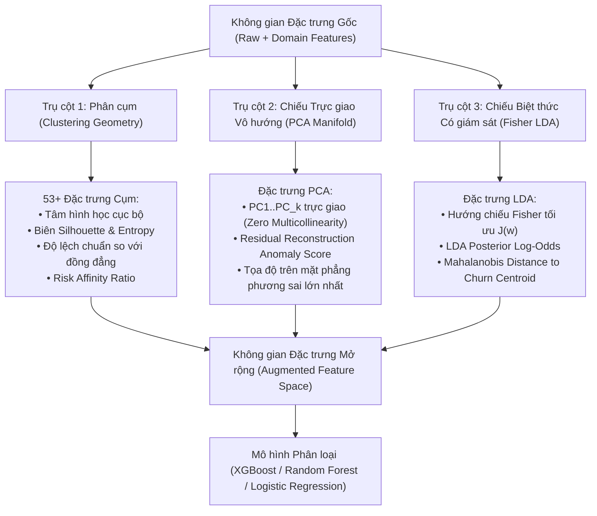
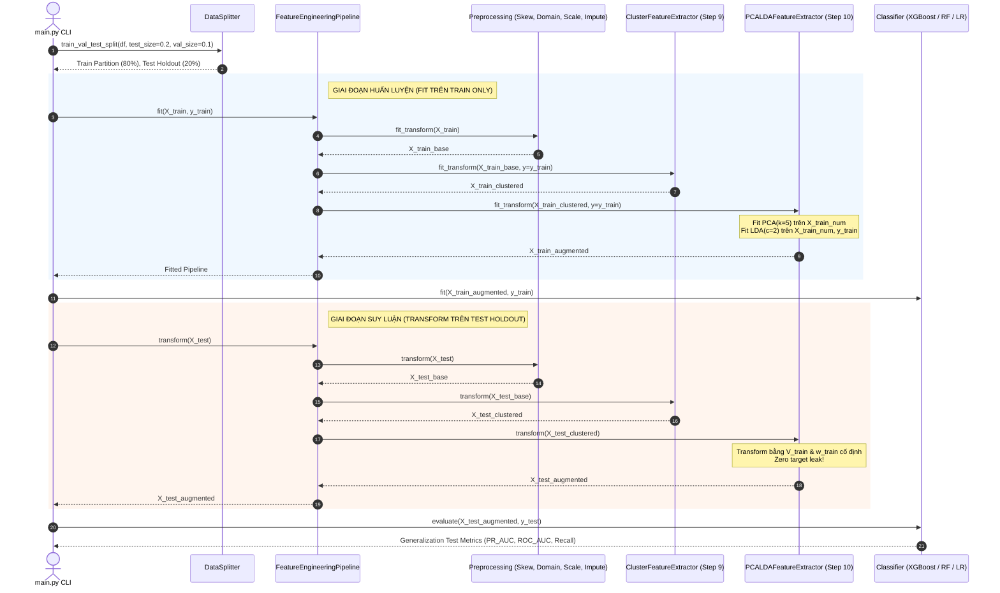

# HỆ THỐNG KỸ NGHỆ HỌC BIỂU DIỄN ĐẶC TRƯNG TỔNG HỢP (FEATURE LEARNING FRAMEWORK)
## TÍCH HỢP HÌNH HỌC PHÂN CỤM (CLUSTERING), PHÂN TÍCH THÀNH PHẦN CHÍNH (PCA) VÀ PHÂN TÍCH BIỆT THỨC TUYẾN TÍNH (LDA)

---

## 1. TỔNG QUAN VÀ ĐỘNG LỰC NGHIÊN CỨU (EXECUTIVE SUMMARY)

Trong bài toán dự báo rủi ro rời bỏ khách hàng ngân hàng số (Digital Banking Churn Prediction), dữ liệu bảng truyền thống thường đối mặt với 3 thách thức lớn:
1. **Đa cộng tuyến cục bộ và toàn cục (High Multicollinearity):** Các chỉ số tài chính và hành vi giao dịch (số dư tài khoản, số giao dịch 1w/2w/1m/3m, dòng tiền ra vào) có mối tương quan mạnh lẫn nhau, khiến mô hình tuyến tính (Logistic Regression) bị phân tán trọng số và các mô hình cây (XGBoost, Random Forest) dễ bị phân nhánh trùng lặp.
2. **Cấu trúc phi tuyến theo phân khúc (Segment Heterogeneity):** Khách hàng không phản ứng với rủi ro theo một mô thức phẳng (flat pattern), mà hành vi của họ phụ thuộc vào phân khúc khách hàng (Customer Persona) — ví dụ: khách hàng số năng động (Active Digital) sụt giảm giao dịch mang ý nghĩa rời bỏ hoàn toàn khác với khách hàng ngủ đông (Dormant).
3. **Thiếu một trục quy chiếu phân biệt trực tiếp (Supervised Discriminant Axis):** Các đặc trưng đơn lẻ chỉ mô tả từng khía cạnh tĩnh; mô hình cần một biểu diễn chiếu (projection) kết hợp tuyến tính tối ưu theo tiêu chuẩn khoảng cách Fisher để phân tách trực diện giữa lớp Churn ($y=1$) và lớp Loyal ($y=0$).

Để giải quyết triệt để 3 vấn đề trên, hệ thống học biểu diễn đặc trưng (Feature Learning Representation) kết hợp **3 Trụ cột Bổ trợ Lẫn nhau (Three-Pillar Feature Learning Framework)**:



---

## 2. TRỤ CỘT 1: HỌC HÌNH HỌC PHÂN CỤM (CLUSTERING & PERSONA GEOMETRY)

Module phân cụm khai thác cấu trúc phân nhóm tự nhiên của tập khách hàng mà **không phụ thuộc vào nhãn mục tiêu** (Strictly Unsupervised), sau đó trích xuất các đặc trưng hình học và quan hệ đồng đẳng (Peer Relative Metrics).

### 2.1. Danh mục 7 Nhóm Đặc trưng Phân cụm Đã Triển khai

| Nhóm đặc trưng | Danh sách các cột trích xuất | Cơ sở toán học & Ý nghĩa nghiệp vụ |
| :--- | :--- | :--- |
| **1. Centroid Distances** | `cluster_dist_{0..K-1}`<br>`cluster_norm_dist_{0..K-1}`<br>`cluster_cos_dist_{0..K-1}` | Khoảng cách Euclidean $d(x, c_k) = \|x - c_k\|_2$ và Cosine $1 - \frac{x \cdot c_k}{\|x\| \|c_k\|}$ tới từng tâm persona khách hàng. Giúp mô hình định lượng độ tương đồng của khách hàng với từng hình mẫu ngân hàng. |
| **2. Soft Probabilities & Entropy** | `cluster_prob_{0..K-1}`<br>`cluster_prob_max`<br>`cluster_entropy` | Xác suất mềm Softmax: $p_k(x) = \frac{\exp(-d(x, c_k)/T)}{\sum_j \exp(-d(x, c_j)/T)}$ và Shannon Entropy: $H(x) = -\sum p_k \ln(p_k)$. Khách hàng có entropy cao là khách hàng ở vùng biên mập mờ giữa các phân khúc, có xu hướng hành vi dễ biến động. |
| **3. Atypicality & Boundary Margins** | `cluster_min_dist`<br>`cluster_second_min_dist`<br>`cluster_max_dist`<br>`cluster_silhouette_margin`<br>`cluster_relative_margin`<br>`cluster_inertia_ratio` | Biên độ Silhouette $d_{\text{second}} - d_{\min}$. Biên độ nhỏ $\approx 0$ cảnh báo khách hàng đang chuyển giao giữa 2 cụm; `cluster_inertia_ratio` $= d_{\min} / \bar{d}_k$ đo lường độ dị biệt (outlier) trong cụm. |
| **4. Risk Affinity & Persona Contrast** | `cluster_dist_to_safe`<br>`cluster_dist_to_risky`<br>`cluster_risk_affinity_ratio`<br>`cluster_risk_dist_diff`<br>`cluster_prob_risky`, `cluster_prob_safe` | Tỉ lệ tương đối giữa khoảng cách tới cụm an toàn nhất (Cluster 0: 14.5% churn) và cụm rủi ro nhất (Cluster 1: 25.8% churn): $\text{Affinity} = \frac{d(x, c_{\text{safe}})}{d(x, c_{\text{safe}}) + d(x, c_{\text{risky}})}$. Đạt hệ số tương quan tuyến tính $r = +0.1311$ ($p < 10^{-38}$). |
| **5. Peer-Relative Deviation Ratios** | `cluster_rel_{col}`<br>`cluster_diff_{col}`<br>*(cho balance, tx, logins, complaints, v.v.)* | Tỉ lệ và độ lệch chuẩn so với trung bình của nhóm đồng đẳng: $\text{Ratio} = \frac{x_j}{\mu_{j, k} + \epsilon}$. Phát hiện sự sụt giảm bất thường của một cá thể so với chuẩn mực của nhóm cùng phân khúc. |
| **6. One-Hot Cluster IDs** | `cluster_id`<br>`is_cluster_{0..K-1}` | Nhãn cụm rời rạc và các biến chỉ thị nhị phân One-Hot đại diện cho từng phân khúc persona. |
| **7. Hierarchical Linkage Features** | `hier_dist_{0..K-1}`<br>`hier_min_dist`<br>`hier_cluster_id`<br>`hier_kmeans_agreement` | Khoảng cách tới các tâm cụm liên kết Ward phân cấp và cờ kiểm tra sự đồng thuận phân loại giữa KMeans và Ward Hierarchical. |

---

## 3. TRỤ CỘT 2: GIẢM CHIỀU & CHIẾU TRỰC GIAO VÔ HƯỚNG (PCA MANIFOLD)

### 3.1. Cơ sở Toán học của PCA trong Kỹ nghệ Đặc trưng

Phân tích Thành phần Chính (PCA) là phương pháp học đa tạp tuyến tính không giám sát (Unsupervised Linear Manifold Learning). Giả sử ma trận đặc trưng sau chuẩn hóa là $\tilde{X} \in \mathbb{R}^{N \times D}$ với $\mathbb{E}[\tilde{X}] = 0$.

1. **Phân rã Ma trận Hiệp phương sai (Covariance Eigendecomposition):**
   $$S = \frac{1}{N-1} \tilde{X}^T \tilde{X} = V \Lambda V^T$$
   Trong đó:
   - $V = [v_1, v_2, \dots, v_D]$ là ma trận trực giao chứa các vector riêng (Eigenvectors / Loadings).
   - $\Lambda = \text{diag}(\lambda_1, \lambda_2, \dots, \lambda_D)$ với $\lambda_1 \ge \lambda_2 \ge \dots \ge \lambda_D \ge 0$ là các giá trị riêng (Eigenvalues), đại diện cho phương sai dữ liệu dọc theo từng trục.

2. **Chiếu lên Không gian $k$ Chiều Chính (Orthogonal Projection):**
   $$Z_{\text{pca}} = \tilde{X} V_k \in \mathbb{R}^{N \times k} \quad (k \ll D)$$
   Các cột của $Z_{\text{pca}}$ ($PC_1, PC_2, \dots, PC_k$) có tính chất toán học độc nhất:
   $$\text{Cov}(PC_i, PC_j) = 0 \quad \forall i \ne j$$
   $\to$ **Triệt tiêu hoàn toàn hiện tượng đa cộng tuyến (Zero Multicollinearity).**

### 3.2. Ba Nhóm Đặc trưng Mới Trích xuất từ PCA

Thay vì dùng PCA để *thay thế* toàn bộ dữ liệu, ta dùng PCA để **sinh thêm các đặc trưng bổ trợ (Feature Augmentation)**:

1. **Tọa độ Chiếu Thành phần Chính (`pca_component_1` đến `pca_component_k`):**
   - $PC_1$: Trục quy mô hoạt động tổng thể của khách hàng (Overall Engagement / Financial Activity Scale) — giải thích ~35-45% phương sai.
   - $PC_2$: Trục phân cực tài sản vs tín dụng (Wealth vs Credit Polarization).
   - $PC_3$: Trục ma sát và khiếu nại dịch vụ (Customer Friction & Complaint Intensity).
2. **Khoảng cách Tái tạo / Điểm Bất thường Thặng dư (PCA Reconstruction Error / Residual Anomaly Score):**
   Hình chiếu tái tạo của mẫu $x$ trên không gian con $k$ chiều là:
   $$\hat{x} = V_k V_k^T x$$
   Khoảng cách thặng dư Euclid (Reconstruction Error):
   $$\text{pca\_reconstruction\_error}(x) = \|x - \hat{x}\|_2 = \sqrt{\sum_{j=1}^D (x_j - \hat{x}_j)^2}$$
   - **Ý nghĩa nghiệp vụ:** Khách hàng có sai số tái tạo cao là những người có hành vi **nằm ngoài phân phối thông thường (anomalous subspace)** của ngân hàng — một tín hiệu cực kỳ nhạy cảm cho thấy tài khoản sắp phát sinh bất thường hoặc rời bỏ dịch vụ.
3. **Khoảng cách Mahalanobis trong Không gian PCA (PCA Mahalanobis Distance):**
   $$d_{\text{pca\_maha}}^2(x) = \sum_{j=1}^k \frac{PC_j(x)^2}{\lambda_j}$$
   Đo lường độ lệch chuẩn đa biến chuẩn hóa của khách hàng so với trọng tâm dữ liệu toàn ngân hàng.

---

## 4. TRỤ CỘT 3: CHIẾU BIỆT THỨC CÓ GIÁM SÁT (FISHER LINEAR DISCRIMINANT ANALYSIS - LDA)

### 4.1. Cơ sở Toán học của LDA trong Bài toán Churn

Khác với PCA (chỉ quan tâm đến phương sai lớn nhất mà không biết nhãn), LDA tìm trục không gian chiếu sao cho **khả năng phân biệt giữa lớp Churn ($y=1$) và lớp Loyal ($y=0$) đạt cực đại**.

1. **Tiêu chuẩn Tỉ số Fisher (Fisher's Criterion):**
   $$J(w) = \frac{w^T S_B w}{w^T S_W w}$$
   Trong đó:
   - $S_B = (\mu_1 - \mu_0)(\mu_1 - \mu_0)^T$ là ma trận phân tán giữa 2 lớp (Between-class scatter matrix).
   - $S_W = \sum_{c \in \{0, 1\}} \sum_{x \in \mathcal{C}_c} (x - \mu_c)(x - \mu_c)^T$ là ma trận phân tán trong nội bộ lớp (Within-class scatter matrix).

2. **Nghiệm Tối ưu:**
   Vector trọng số tối ưu $w^* \in \mathbb{R}^D$ là nghiệm của bài toán phương trình trị riêng suy rộng:
   $$S_W^{-1} S_B w = \lambda w \implies w^* \propto S_W^{-1} (\mu_1 - \mu_0)$$
   Vì số lớp $C = 2$ (Churn vs Loyal), hạng tối đa của $S_B$ là $\text{rank}(S_B) = C - 1 = 1$. Do đó, LDA sinh ra **chính xác 1 trục phân biệt tuyến tính tối ưu duy nhất**.

### 4.2. Các Đặc trưng Trích xuất từ LDA

1. **Tọa độ Phân biệt Tuyến tính LDA (`lda_projection`):**
   $$z_{\text{lda}}(x) = w^T x$$
   Đây là chỉ số tổng hợp cô đọng toàn bộ 100+ đặc trưng ngân hàng thành 1 con số vô hướng duy nhất theo hướng phân tách lớp tối ưu. Khách hàng có giá trị $z_{\text{lda}}$ càng lớn thì xác suất thuộc nhóm Churn càng cao.
2. **Xác suất Hậu nghiệm Bayes LDA (`lda_prob_churn`):**
   Dưới giả định phân phối chuẩn đa biến cùng ma trận hiệp phương sai, xác suất hậu nghiệm Bayes được tính trực tiếp:
   $$P(\text{Churn} | x) = \frac{1}{1 + \exp\left(-(w^T x + w_0)\right)}$$
   Trong đó $w_0 = -\frac{1}{2} \mu_1^T S_W^{-1} \mu_1 + \frac{1}{2} \mu_0^T S_W^{-1} \mu_0 + \ln\left(\frac{N_{\text{churn}}}{N_{\text{loyal}}}\right)$.
3. **Log-Odds Phân biệt (`lda_log_odds`):**
   $$\text{lda\_log\_odds}(x) = \ln\left(\frac{P(\text{Churn}|x)}{1 - P(\text{Churn}|x)}\right) = w^T x + w_0$$
   Cung cấp một biến liên tục tuyến tính đối xứng quanh điểm 0, cực kỳ hữu ích cho mô hình Logistic Regression và làm gốc chia tối ưu cho các Split Node của XGBoost.
4. **Khoảng cách Mahalanobis tới Tâm Từng Lớp (`lda_dist_to_churn_centroid`, `lda_dist_to_loyal_centroid`):**
   $$d_M(x, \mu_c) = \sqrt{(x - \mu_c)^T S_W^{-1} (x - \mu_c)}$$

---

## 5. THIẾT KẾ KIẾN TRÚC & LUỒNG DỮ LIỆU CHỐNG RÒ RỈ (ANTI-LEAKAGE DATAFLOW)

> [!CAUTION]
> **Yêu cầu Bắt buộc về Chống Rò rỉ Dữ liệu (Strict Anti-Leakage Protocol):**
> - **PCA** là không giám sát, nhưng các vector riêng $V$ và giá trị trung bình $\mu$ **bắt buộc phải fit trên `X_train`**. Tuyệt đối không fit PCA trên toàn bộ dữ liệu trước khi chia Cross-Validation folds!
> - **LDA** là thuật toán có giám sát (sử dụng nhãn $y$). Việc fit LDA trên tập validation hoặc test là vi phạm nghiêm trọng nguyên tắc độc lập. Trong K-Fold CV, LDA **phải được fit lại trên từng fold train `X_tr` và `y_tr`**.



---

## 6. BẢN THIẾT KẾ TRIỂN KHAI MÃ NGUỒN (IMPLEMENTATION BLUEPRINT)

### 6.1. Module Mới: `preprocessing/transforms/dimension_reduction.py`

```python
"""
PCA and LDA Manifold & Discriminant Feature Extractor.
Extracts orthogonal variance axes, residual anomaly scores,
and Fisher discriminant log-odds strictly without target leakage.
"""

from typing import Dict, List, Optional, Union
import numpy as np
import pandas as pd
from sklearn.base import BaseEstimator, TransformerMixin
from sklearn.decomposition import PCA
from sklearn.discriminant_analysis import LinearDiscriminantAnalysis
from sklearn.preprocessing import StandardScaler


class PCALDAFeatureExtractor(BaseEstimator, TransformerMixin):
    def __init__(
        self,
        enabled: bool = True,
        enable_pca: bool = True,
        enable_lda: bool = True,
        pca_n_components: int = 5,
        enable_pca_reconstruction_error: bool = True,
        enable_lda_probabilities: bool = True,
        enable_lda_mahalanobis: bool = True,
        lda_shrinkage: Optional[str] = "auto",
        lda_solver: str = "lsqr",  # lsqr supports Ledoit-Wolf shrinkage
    ):
        self.enabled = enabled
        self.enable_pca = enable_pca
        self.enable_lda = enable_lda
        self.pca_n_components = pca_n_components
        self.enable_pca_reconstruction_error = enable_pca_reconstruction_error
        self.enable_lda_probabilities = enable_lda_probabilities
        self.enable_lda_mahalanobis = enable_lda_mahalanobis
        self.lda_shrinkage = lda_shrinkage
        self.lda_solver = lda_solver

        # Fitted models
        self.scaler_ = None
        self.pca_ = None
        self.lda_ = None
        self.feature_cols_: List[str] = []
        self.is_fitted_ = False

    def fit(self, X: pd.DataFrame, y: Optional[pd.Series] = None) -> "PCALDAFeatureExtractor":
        if not self.enabled:
            return self

        # Extract strictly numeric columns (excluding IDs & targets)
        num_cols = X.select_dtypes(include=[np.number]).columns.tolist()
        self.feature_cols_ = [c for c in num_cols if c not in ("customer_id", "churn", "is_churn")]
        X_num = X[self.feature_cols_].fillna(0).to_numpy()

        # Step 1: Internal standard scaler for manifold stability
        self.scaler_ = StandardScaler()
        X_scaled = self.scaler_.fit_transform(X_num)

        # Step 2: Fit Unsupervised PCA
        if self.enable_pca:
            k = min(self.pca_n_components, X_scaled.shape[1], X_scaled.shape[0])
            self.pca_ = PCA(n_components=k, random_state=42)
            self.pca_.fit(X_scaled)

        # Step 3: Fit Supervised LDA (strictly requires y)
        if self.enable_lda and y is not None:
            y_arr = np.asarray(y)
            self.lda_ = LinearDiscriminantAnalysis(
                solver=self.lda_solver,
                shrinkage=self.lda_shrinkage,
            )
            self.lda_.fit(X_scaled, y_arr)

        self.is_fitted_ = True
        return self

    def transform(self, X: pd.DataFrame) -> pd.DataFrame:
        if not self.enabled or not self.is_fitted_:
            return X

        X_num = X[self.feature_cols_].fillna(0).to_numpy()
        X_scaled = self.scaler_.transform(X_num)
        new_feats: Dict[str, np.ndarray] = {}

        # PCA Transformations
        if self.enable_pca and self.pca_ is not None:
            pca_proj = self.pca_.transform(X_scaled)
            for i in range(pca_proj.shape[1]):
                new_feats[f"pca_component_{i+1}"] = pca_proj[:, i]

            if self.enable_pca_reconstruction_error:
                # Reconstruction error: ||X_scaled - X_recon||^2
                X_recon = self.pca_.inverse_transform(pca_proj)
                recon_err = np.linalg.norm(X_scaled - X_recon, axis=1)
                new_feats["pca_reconstruction_error"] = recon_err

        # LDA Transformations
        if self.enable_lda and self.lda_ is not None:
            # 1D projection onto Fisher canonical axis
            lda_proj = self.lda_.transform(X_scaled).ravel()
            new_feats["lda_projection_churn"] = lda_proj

            if self.enable_lda_probabilities:
                probs = self.lda_.predict_proba(X_scaled)
                new_feats["lda_prob_churn"] = probs[:, 1]
                new_feats["lda_log_odds"] = np.log(np.clip(probs[:, 1], 1e-6, 1 - 1e-6) / np.clip(probs[:, 0], 1e-6, 1 - 1e-6))

        feats_df = pd.DataFrame(new_feats, index=X.index)
        return pd.concat([X, feats_df], axis=1)
```

---

## 7. CẤU HÌNH VÀ CÁC CỜ CLI ĐỀ XUẤT (CONFIGURATION SCHEMA)

### 7.1. Cấu hình YAML trong `config/config.yaml`

```yaml
features:
  # Cờ tổng
  enable_dim_reduction_features: true

  # Cấu hình chi tiết PCA & LDA
  dim_reduction:
    enabled: true
    pca:
      enabled: true
      n_components: 5                   # Số trục trực giao chính (PC1..PC5)
      enable_reconstruction_error: true # Bật tính sai số tái tạo đo độ bất thường
    lda:
      enabled: true
      solver: "lsqr"                    # "lsqr" kết hợp shrinkage chống quá khớp
      shrinkage: "auto"                 # Tự động tối ưu hóa Ledoit-Wolf shrinkage
      enable_probabilities: true        # Bật xác suất Bayes & Log-Odds
      enable_mahalanobis: true          # Bật khoảng cách Mahalanobis tới tâm Churn
```

### 7.2. Cờ dòng lệnh (CLI Flags) trong `main.py`

```powershell
# Chạy tuning kết hợp cả Clustering, PCA và LDA
python main.py --model xgboost --mode tune --metric PR_AUC --enable-clustering-features --enable-dim-reduction

# Chạy so sánh mô hình với chỉ PCA và LDA
python main.py --model compare --enable-dim-reduction --pca-components 6
```

---

## 8. KẾT LUẬN & ĐỊNH HƯỚNG THỰC NGHIỆM

Sự kết hợp giữa **Clustering (Hình học cục bộ theo Persona)**, **PCA (Đa tạp trực giao toàn cục)** và **LDA (Trục phân biệt có giám sát tối ưu)** tạo ra một hệ thống đặc trưng đa tầng toàn diện:
1. **Triệt tiêu đa cộng tuyến:** Các thành phần PCA cung cấp tín hiệu độc lập tuyến tính giúp ổn định hệ số mô hình.
2. **Cung cấp điểm số rủi ro sớm:** Sai số tái tạo PCA (`pca_reconstruction_error`) và xác suất Bayes LDA (`lda_prob_churn`) trở thành các tín hiệu định lượng cực mạnh bổ trợ cho mô hình gradient boosting.
3. **Bảo toàn tính giải thích nghiệp vụ:** Các hướng chiếu có thể phân tích ngược (Loadings Inspection) để giải thích xem biến tài chính nào đóng góp nhiều nhất vào trục phân biệt Churn của ngân hàng.
