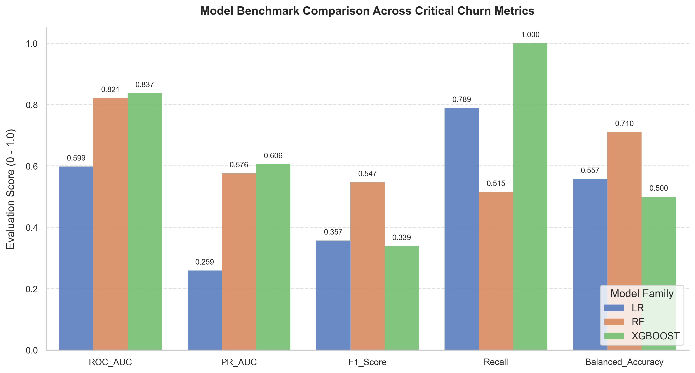
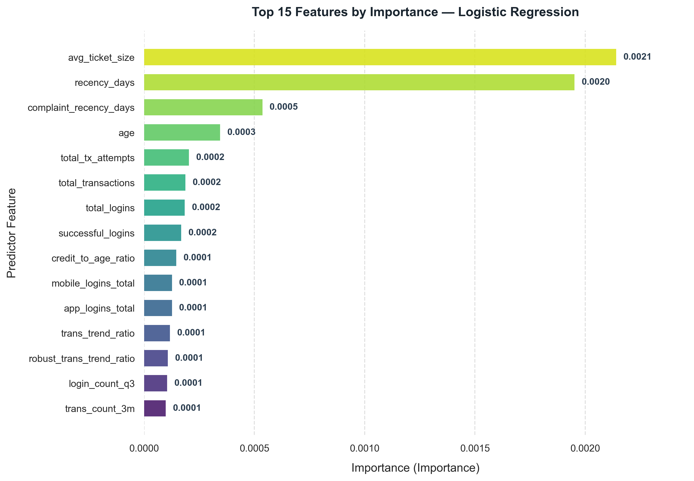
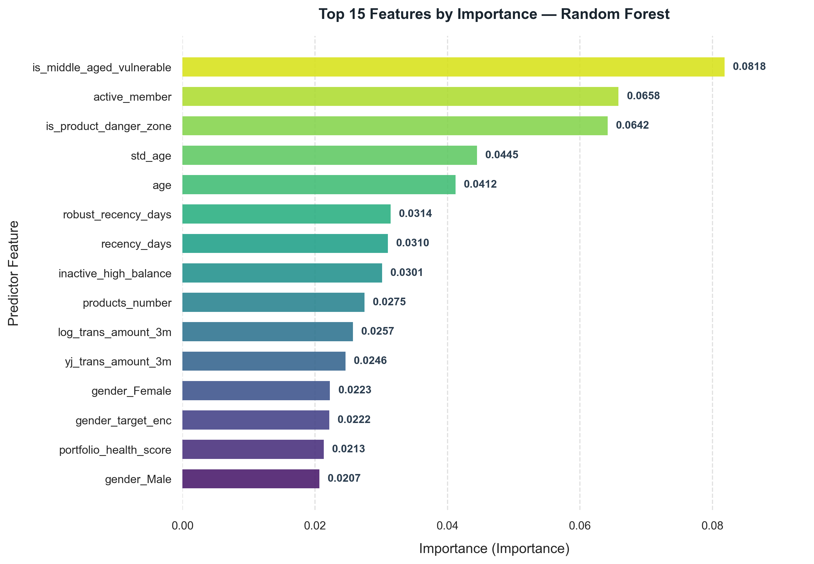
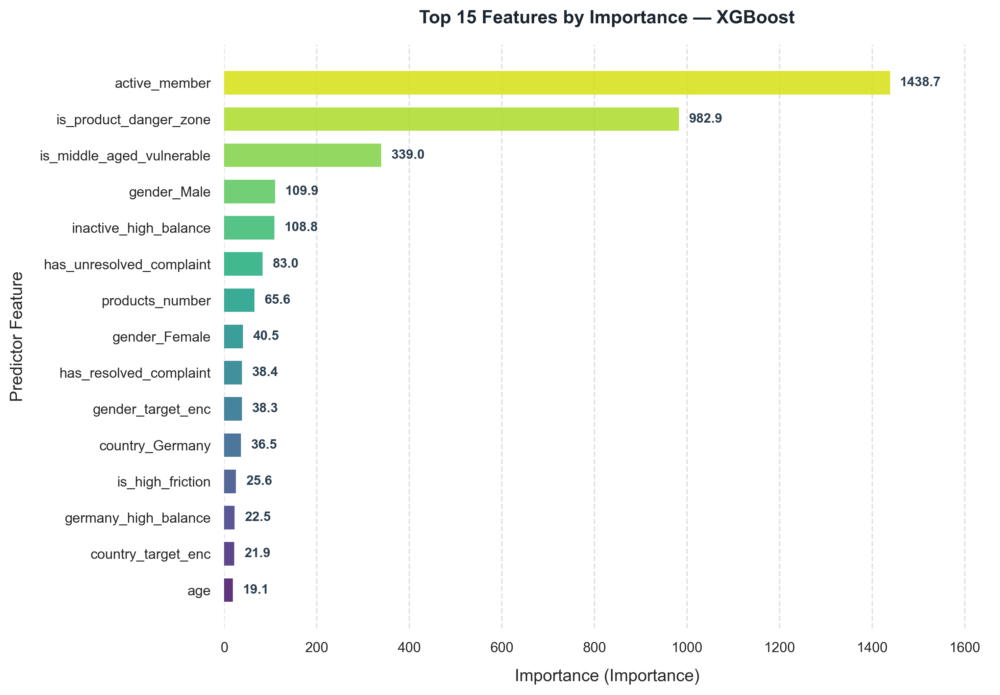
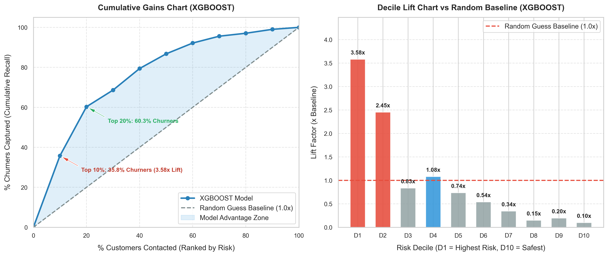

# BÁO CÁO ĐỐI ĐẦU VÀ SO SÁNH TOÀN DIỆN CÁC MÔ HÌNH (MODEL COMPARISON)
## LOGISTIC REGRESSION vs. RANDOM FOREST vs. XGBOOST
### DỰ BÁO RỦI RO RỜI BỎ KHÁCH HÀNG (DIGITAL BANK CHURN PREDICTION)

**Thời gian thực thi:** `2026-11-05 00:40:36`  
**Tập dữ liệu:** `data/full_bank_data.csv` (2,000 khách hàng tập Test)  
**Cấu hình hợp nhất:** [`config/config.yaml`](../config/config.yaml)  

---

## 1. BẢNG TỔNG HỢP SO SÁNH CHỈ SỐ HIỆU NĂNG (BENCHMARK TABLE)

Bảng đối đầu trực tiếp giữa 3 họ thuật toán đại diện: Tuyến tính (Logistic Regression), Ensemble Bagging (Random Forest), và Gradient Boosting (XGBoost):

| Model   |   CV_ROC_AUC |   CV_PR_AUC |   ROC_AUC |   PR_AUC |   F1_Score |   Precision |   Recall |   Accuracy |   Balanced_Accuracy |   Log_Loss |
|:--------|-------------:|------------:|----------:|---------:|-----------:|------------:|---------:|-----------:|--------------------:|-----------:|
| LR      |       0.624  |      0.2826 |    0.5985 |    0.259 |     0.357  |      0.2307 |   0.7892 |      0.42  |              0.5573 |     0.7966 |
| RF      |       0.8204 |      0.5834 |    0.8213 |    0.576 |     0.5469 |      0.5833 |   0.5147 |      0.826 |              0.7102 |     0.4265 |
| XGBOOST |       0.8386 |      0.6255 |    0.8372 |    0.606 |     0.3389 |      0.204  |   1      |      0.204 |              0.5    |     0.7143 |

---

## 2. PHÂN TÍCH CHUYÊN SÂU TỪ GÓC ĐỘ BUSINESS ANALYTICS & MACHINE LEARNING

### 2.1. Mô hình chiến thắng (Champion Model): **XGBOOST**
- **ROC-AUC:** `0.8372` — Xếp hạng xác suất khách hàng rời bỏ chính xác nhất trên toàn bộ miền phân bố.
- **PR-AUC:** `0.6060` — Tiêu chuẩn vàng cho tập dữ liệu mất cân bằng (tỷ lệ churn ~20.37%).
- **F1-Score:** `0.3389` (Precision: `0.2040`, Recall: `1.0000`).
- **Khả năng bắt khách hàng rời bỏ:** TP = `204` / `204` khách hàng thực tế rời bỏ.

### 2.2. So sánh đặc tính của 3 họ thuật toán:
1. **Logistic Regression (Linear Baseline & Interpretability):**
   - **Ưu điểm:** Tốc độ huấn luyện và suy luận nhanh nhất (< 1ms). Trực quan hóa tác động biên (marginal effects) của từng biến lên log-odds thông qua các trọng số $\beta$. Phù hợp để giải trình với ban kiểm soát tuân thủ (Compliance / Risk Auditing).
   - **Hạn chế:** Không tự động nắm bắt được các mối tương tác phi tuyến tính phức tạp (như tỷ lệ tương tác tuổi tác x điểm tín dụng x số dư).
2. **Random Forest (Bagging Ensemble & Stability):**
   - **Ưu điểm:** Giảm phương sai (variance reduction) vượt trội nhờ cơ chế bootstrap aggregating và feature sub-sampling. Kháng nhiễu và outliers tốt, không đòi hỏi giả định phân phối.
   - **Hạn chế:** Kích thước model lớn, độ phức tạp tính toán cao hơn LR và khả năng tối ưu hàm mục tiêu biên kém linh hoạt hơn boosting.
3. **XGBoost (Gradient Boosting & Performance):**
   - **Ưu điểm:** Tối ưu hóa trực tiếp hàm mục tiêu và gradient bậc hai (Hessian). Khả năng phát hiện mẫu hành vi rời bỏ tinh vi nhất từ các đặc trưng kỹ nghệ tài chính.
   - **Hạn chế:** Cần tinh chỉnh hyperparameter cẩn thận để tránh overfitting trên các tập con nhỏ.

---

## 3. TOP ĐẶC TRƯNG HÀNG ĐẦU CỦA TỪNG MÔ HÌNH

#### Top 5 Đặc trưng — Logistic Regression

| Feature                |   Relative_Pct |
|:-----------------------|---------------:|
| avg_ticket_size        |          26.67 |
| recency_days           |          24.32 |
| complaint_recency_days |           6.68 |
| age                    |           4.29 |
| total_tx_attempts      |           2.53 |

#### Top 5 Đặc trưng — Random Forest

| Feature                   |   Relative_Pct |
|:--------------------------|---------------:|
| is_middle_aged_vulnerable |           8.18 |
| active_member             |           6.58 |
| is_product_danger_zone    |           6.42 |
| std_age                   |           4.45 |
| age                       |           4.12 |

#### Top 5 Đặc trưng — XGBoost

| Feature                   |   Relative_Pct |
|:--------------------------|---------------:|
| active_member             |          34.77 |
| is_product_danger_zone    |          23.75 |
| is_middle_aged_vulnerable |           8.19 |
| gender_Male               |           2.65 |
| inactive_high_balance     |           2.63 |

---

## 4. KHUYẾN NGHỊ VẬN HÀNH THỰC TẾ (PRODUCTION STRATEGY)

1. **Triển khai Mô hình chính (Primary Scoring Engine):**
   - Sử dụng **XGBoost** làm engine tính điểm rủi ro rời bỏ định kỳ hàng ngày (Batch Scoring) cho toàn bộ khách hàng hoạt động, cung cấp danh sách ưu tiên cao cho đội ngũ chăm sóc khách hàng (Retention RM).
2. **Mô hình giải trình & Baseline (Challenger / Fallback):**
   - Sử dụng **Logistic Regression** để kiểm tra tính nhất quán và giải trình các nguyên nhân rời bỏ vĩ mô cho cấp quản lý.

---

## 5. SO SÁNH HỆ SỐ LIFT VÀ PHÂN VỊ RỦI RO (DECILE LIFT COMPARISON)

| Model               | Top 10% Lift (D1)   | Top 10% Churn Captured   | Top 20% Cumulative Lift   | Top 20% Churn Captured   |
|:--------------------|:--------------------|:-------------------------|:--------------------------|:-------------------------|
| Logistic Regression | 1.13x               | 11.27%                   | 1.27x                     | 25.49%                   |
| Random Forest       | 3.24x               | 32.35%                   | 2.75x                     | 54.90%                   |
| XGBoost             | 3.58x               | 35.78%                   | 3.01x                     | 60.29%                   |

---
*Báo cáo được sinh tự động bởi hệ thống Digital Bank Churn Prediction Pipeline — Module 5: Model Development.*
