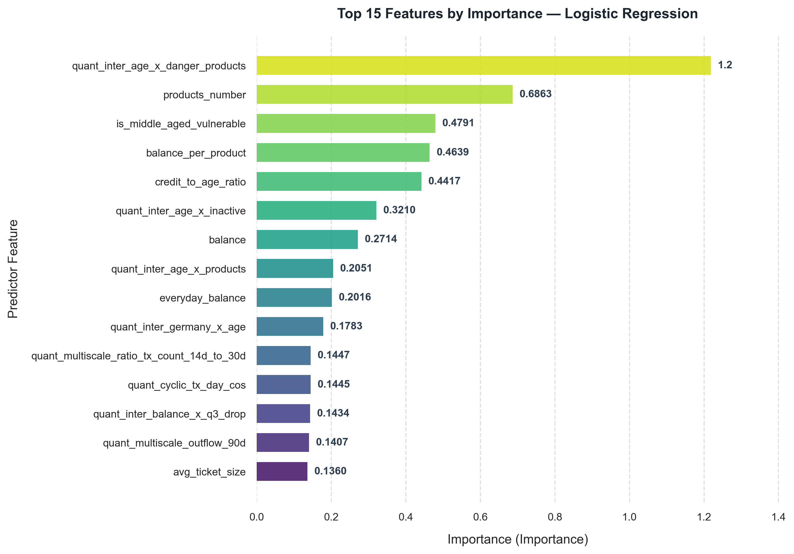
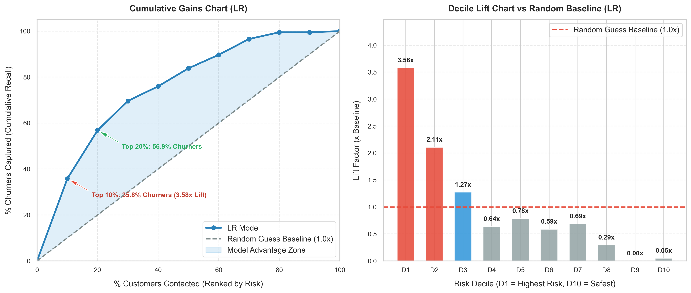

# BÁO CÁO HUẤN LUYỆN MÔ HÌNH LOGISTIC REGRESSION (TRAINING REPORT)
## DỰ BÁO RỦI RO RỜI BỎ KHÁCH HÀNG (CUSTOMER CHURN PREDICTION)

**Thời gian huấn luyện:** `2026-11-17 14:33:10`  
**Mô hình:** `Logistic Regression`  
**Artifact đã lưu:** `models/saved/lr_churn.pkl`  
**Cấu hình:** [`config/config.yaml`](../config/config.yaml)  

---

## 1. KẾT QUẢ ĐÁNH GIÁ TRÊN TẬP TEST

### 1.1. Chỉ số hiệu năng phân loại (Performance Metrics)

| Chỉ số (Metric)   |   Giá trị | Ý nghĩa Nghiệp vụ                                                    |
|:------------------|----------:|:---------------------------------------------------------------------|
| ROC_AUC           |    0.8306 | Khả năng phân biệt tổng thể giữa khách hàng rời bỏ và ở lại          |
| PR_AUC            |    0.6314 | Độ chính xác trung bình trên dữ liệu mất cân bằng (Baseline: ~20.4%) |
| F1_Score          |    0.4985 | Trung bình điều hòa giữa Precision và Recall                         |
| Precision         |    0.3556 | Tỷ lệ khách hàng cảnh báo rời bỏ thực sự rời bỏ                      |
| Recall            |    0.8333 | Tỷ lệ nhận diện thành công khách hàng rời bỏ thực tế                 |
| Accuracy          |    0.658  | Tỷ lệ dự báo đúng trên toàn bộ tập kiểm thử                          |
| Balanced_Accuracy |    0.7232 | Trung bình cộng độ nhạy của 2 lớp (giảm thiên lệch đa số)            |
| Log_Loss          |    0.4922 | Độ mất mát entropy chéo và chất lượng xác suất hiệu chuẩn            |

### 1.2. Thông tin mẫu và cấu hình huấn luyện

| Tham số                                         | Giá trị   |
|:------------------------------------------------|:----------|
| Mô hình thuật toán                              | LR        |
| Ngưỡng quyết định phân lớp (Decision Threshold) | 0.35      |
| Số lượng đặc trưng đầu vào                      | 210       |
| Áp dụng kỹ thuật cân bằng mẫu SMOTE             | False     |
| Kích thước tập huấn luyện ban đầu               | 7999x210  |
| Kích thước tập validation                       | 1001x210  |
| Kích thước tập kiểm thử độc lập                 | 1000x210  |

---

## 2. MA TRẬN NHẦM LẪN (CONFUSION MATRIX)

- **True Positives (TP - Bắt đúng khách hàng rời bỏ):** `170` (83.33% tổng khách hàng rời bỏ)
- **False Negatives (FN - Bỏ sót khách hàng rời bỏ):** `34` (16.67% khách hàng rời bỏ bị bỏ sót)
- **True Negatives (TN - Nhận diện đúng khách hàng ở lại):** `488` (61.31% khách hàng ở lại nhận diện đúng)
- **False Positives (FP - Cảnh báo nhầm khách hàng ở lại):** `308` (38.69% khách hàng ở lại bị cảnh báo nhầm)

---

## 3. TOP 15 ĐẶC TRƯNG QUAN TRỌNG NHẤT

| Feature                                    |   Importance |   Coefficient | Relative_Pct   |
|:-------------------------------------------|-------------:|--------------:|:---------------|
| quant_inter_age_x_danger_products          |       1.2183 |      1.21833  | 15.58%         |
| products_number                            |       0.6863 |     -0.686253 | 8.78%          |
| is_middle_aged_vulnerable                  |       0.4791 |      0.479107 | 6.13%          |
| balance_per_product                        |       0.4639 |     -0.463906 | 5.93%          |
| credit_to_age_ratio                        |       0.4417 |     -0.441738 | 5.65%          |
| quant_inter_age_x_inactive                 |       0.321  |      0.320962 | 4.10%          |
| balance                                    |       0.2714 |      0.27135  | 3.47%          |
| quant_inter_age_x_products                 |       0.2051 |     -0.205072 | 2.62%          |
| everyday_balance                           |       0.2016 |      0.201626 | 2.58%          |
| quant_inter_germany_x_age                  |       0.1783 |      0.178341 | 2.28%          |
| quant_multiscale_ratio_tx_count_14d_to_30d |       0.1447 |     -0.144701 | 1.85%          |
| quant_cyclic_tx_day_cos                    |       0.1445 |     -0.1445   | 1.85%          |
| quant_inter_balance_x_q3_drop              |       0.1434 |     -0.143359 | 1.83%          |
| quant_multiscale_outflow_90d               |       0.1407 |      0.140689 | 1.80%          |
| avg_ticket_size                            |       0.136  |     -0.135966 | 1.74%          |

---

## 4. ĐÁNH GIÁ HỆ SỐ LIFT & 10 PHÂN VỊ RỦI RO (DECILE LIFT & GAINS)

### 4.1. Bảng 10 phân vị rủi ro (Decile Lift Analysis):
* **Top 10% rủi ro cao nhất (Decile D1):** Đạt hệ số **Lift 3.58x** so với chọn ngẫu nhiên.
* **Top 20% rủi ro cao nhất (Decile D1 + D2):** Đạt hệ số **Cumulative Lift 2.84x**.

| Decile   |   Customers |   Churners | Churn_Rate   | Decile_Lift   | Cum_Recall   | Cum_Lift   |
|:---------|------------:|-----------:|:-------------|:--------------|:-------------|:-----------|
| D1       |         100 |         73 | 73.00%       | 3.58x         | 35.78%       | 3.58x      |
| D2       |         100 |         43 | 43.00%       | 2.11x         | 56.86%       | 2.84x      |
| D3       |         100 |         26 | 26.00%       | 1.27x         | 69.61%       | 2.32x      |
| D4       |         100 |         13 | 13.00%       | 0.64x         | 75.98%       | 1.90x      |
| D5       |         100 |         16 | 16.00%       | 0.78x         | 83.82%       | 1.68x      |
| D6       |         100 |         12 | 12.00%       | 0.59x         | 89.71%       | 1.50x      |
| D7       |         100 |         14 | 14.00%       | 0.69x         | 96.57%       | 1.38x      |
| D8       |         100 |          6 | 6.00%        | 0.29x         | 99.51%       | 1.24x      |
| D9       |         100 |          0 | 0.00%        | 0.00x         | 99.51%       | 1.11x      |
| D10      |         100 |          1 | 1.00%        | 0.05x         | 100.00%      | 1.00x      |

### 4.2. So sánh với các Baselines & Điểm vận hành tối ưu:

| Configuration                              | Threshold   | Accuracy   | Precision   | Recall   |   F1_Score |   ROC_AUC |   PR_AUC | Precision_Lift   | Recall_Lift   | PR_AUC_Lift   |
|:-------------------------------------------|:------------|:-----------|:------------|:---------|-----------:|----------:|---------:|:-----------------|:--------------|:--------------|
| 1. Random Guess Baseline                   | -           | 67.52%     | 20.40%      | 20.40%   |     0.204  |    0.5    |   0.204  | 1.00x            | 1.00x         | 1.00x         |
| 2. Majority Class Baseline (All Non-Churn) | 1.00        | 79.60%     | 0.00%       | 0.00%    |     0      |    0.5    |   0.204  | 0.00x            | 0.00x         | 1.00x         |
| Model @ Default (0.50)                     | 0.50        | 77.00%     | 45.81%      | 69.61%   |     0.5525 |    0.8306 |   0.6314 | 2.25x            | 3.41x         | 3.10x         |
| Model @ Optimal F1                         | 0.59        | 81.60%     | 54.24%      | 62.75%   |     0.5818 |    0.8306 |   0.6314 | 2.66x            | 3.08x         | 3.10x         |
| Model @ Optimal F2 (High Recall)           | 0.28        | 57.80%     | 31.14%      | 88.24%   |     0.4604 |    0.8306 |   0.6314 | 1.53x            | 4.33x         | 3.10x         |
| Model @ Target Recall (>=75%)              | 0.40        | 70.60%     | 38.92%      | 77.45%   |     0.518  |    0.8306 |   0.6314 | 1.91x            | 3.80x         | 3.10x         |
| Model @ Manual (0.35)                      | 0.35        | 65.80%     | 35.56%      | 83.33%   |     0.4985 |    0.8306 |   0.6314 | 1.74x            | 4.08x         | 3.10x         |

---
*Báo cáo được sinh tự động bởi hệ thống Digital Bank Churn Prediction Pipeline — Module 5: Model Development.*
