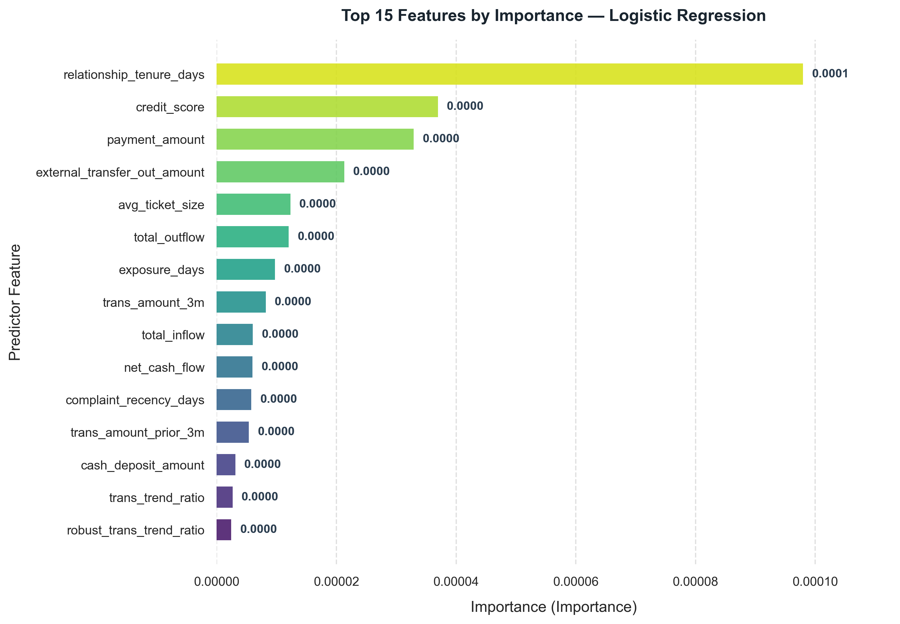
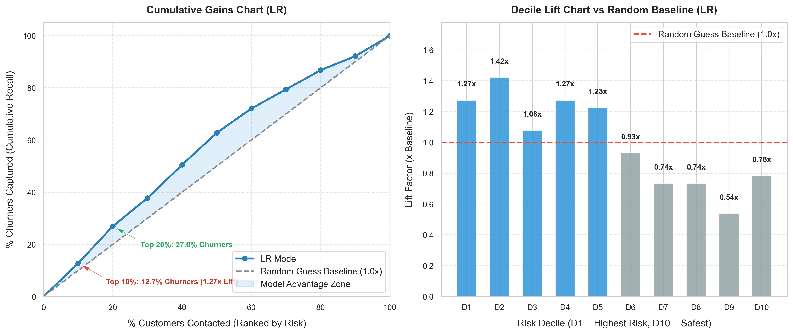

# BÁO CÁO HUẤN LUYỆN MÔ HÌNH LOGISTIC REGRESSION (TRAINING REPORT)
## DỰ BÁO RỦI RO RỜI BỎ KHÁCH HÀNG (CUSTOMER CHURN PREDICTION)

**Thời gian huấn luyện:** `2026-11-05 00:29:57`  
**Mô hình:** `Logistic Regression`  
**Artifact đã lưu:** `models/saved/lr_churn.pkl`  
**Cấu hình:** [`config/config.yaml`](../config/config.yaml)  

---

## 1. KẾT QUẢ ĐÁNH GIÁ TRÊN TẬP TEST

| Metric            | Value      |
|:------------------|:-----------|
| ROC_AUC           | 0.5924     |
| PR_AUC            | 0.2788     |
| F1_Score          | 0.0474     |
| Precision         | 0.7143     |
| Recall            | 0.0245     |
| Accuracy          | 0.7990     |
| Balanced_Accuracy | 0.5110     |
| Log_Loss          | 0.5948     |
| TP                | 5          |
| FP                | 2          |
| TN                | 794        |
| FN                | 199        |
| Experiment        | Single Run |
| Model             | LR         |
| Num_Features      | 133        |
| X_val_Shape       | 1001x133   |
| SMOTE_Applied     | True       |

---

## 2. MA TRẬN NHẦM LẪN (CONFUSION MATRIX)

- **True Positives (TP - Bắt đúng khách hàng rời bỏ):** `5`
- **False Negatives (FN - Bỏ sót khách hàng rời bỏ):** `199`
- **True Negatives (TN - Nhận diện đúng khách hàng ở lại):** `794`
- **False Positives (FP - Cảnh báo nhầm khách hàng ở lại):** `2`

---

## 3. TOP 15 ĐẶC TRƯNG QUAN TRỌNG NHẤT

| Feature                      |   Importance |   Coefficient |   Relative_Pct |
|:-----------------------------|-------------:|--------------:|---------------:|
| relationship_tenure_days     |  9.79667e-05 |  -9.79667e-05 |          34.06 |
| credit_score                 |  3.69588e-05 |  -3.69588e-05 |          12.85 |
| payment_amount               |  3.29282e-05 |  -3.29282e-05 |          11.45 |
| external_transfer_out_amount |  2.13143e-05 |   2.13143e-05 |           7.41 |
| avg_ticket_size              |  1.2315e-05  |  -1.2315e-05  |           4.28 |
| total_outflow                |  1.20311e-05 |  -1.20311e-05 |           4.18 |
| exposure_days                |  9.75085e-06 |  -9.75085e-06 |           3.39 |
| trans_amount_3m              |  8.19826e-06 |  -8.19826e-06 |           2.85 |
| total_inflow                 |  6.0349e-06  |  -6.0349e-06  |           2.1  |
| net_cash_flow                |  5.99619e-06 |   5.99619e-06 |           2.08 |
| complaint_recency_days       |  5.78871e-06 |  -5.78871e-06 |           2.01 |
| trans_amount_prior_3m        |  5.36905e-06 |   5.36905e-06 |           1.87 |
| cash_deposit_amount          |  3.11089e-06 |   3.11089e-06 |           1.08 |
| trans_trend_ratio            |  2.65692e-06 |  -2.65692e-06 |           0.92 |
| robust_trans_trend_ratio     |  2.44285e-06 |  -2.44285e-06 |           0.85 |

---

## 4. ĐÁNH GIÁ HỆ SỐ LIFT & 10 PHÂN VỊ RỦI RO (DECILE LIFT & GAINS)

### 4.1. Bảng 10 phân vị rủi ro (Decile Lift Analysis):
* **Top 10% rủi ro cao nhất (Decile D1):** Đạt hệ số **Lift 1.27x** so với chọn ngẫu nhiên.
* **Top 20% rủi ro cao nhất (Decile D1 + D2):** Đạt hệ số **Cumulative Lift 1.35x**.

| Decile   |   Customers |   Churners | Churn_Rate   | Decile_Lift   | Cum_Recall   | Cum_Lift   |
|:---------|------------:|-----------:|:-------------|:--------------|:-------------|:-----------|
| D1       |         100 |         26 | 26.00%       | 1.27x         | 12.75%       | 1.27x      |
| D2       |         100 |         29 | 29.00%       | 1.42x         | 26.96%       | 1.35x      |
| D3       |         100 |         22 | 22.00%       | 1.08x         | 37.75%       | 1.26x      |
| D4       |         100 |         26 | 26.00%       | 1.27x         | 50.49%       | 1.26x      |
| D5       |         100 |         25 | 25.00%       | 1.23x         | 62.75%       | 1.25x      |
| D6       |         100 |         19 | 19.00%       | 0.93x         | 72.06%       | 1.20x      |
| D7       |         100 |         15 | 15.00%       | 0.74x         | 79.41%       | 1.13x      |
| D8       |         100 |         15 | 15.00%       | 0.74x         | 86.76%       | 1.08x      |
| D9       |         100 |         11 | 11.00%       | 0.54x         | 92.16%       | 1.02x      |
| D10      |         100 |         16 | 16.00%       | 0.78x         | 100.00%      | 1.00x      |

### 4.2. So sánh với các Baselines & Điểm vận hành tối ưu:
| Configuration                              | Threshold   | Accuracy   | Precision   | Recall   |   F1_Score |   ROC_AUC |   PR_AUC | Precision_Lift   | Recall_Lift   | PR_AUC_Lift   |
|:-------------------------------------------|:------------|:-----------|:------------|:---------|-----------:|----------:|---------:|:-----------------|:--------------|:--------------|
| 1. Random Guess Baseline                   | -           | 67.52%     | 20.40%      | 20.40%   |     0.204  |    0.5    |   0.204  | 1.00x            | 1.00x         | 1.00x         |
| 2. Majority Class Baseline (All Non-Churn) | 1.00        | 79.60%     | 0.00%       | 0.00%    |     0      |    0.5    |   0.204  | 0.00x            | 0.00x         | 1.00x         |
| Model @ Default (0.50)                     | 0.50        | 79.90%     | 71.43%      | 2.45%    |     0.0474 |    0.5924 |   0.2788 | 3.50x            | 0.12x         | 1.37x         |
| Model @ Optimal F1                         | 0.36        | 31.50%     | 21.67%      | 90.20%   |     0.3495 |    0.5924 |   0.2788 | 1.06x            | 4.42x         | 1.37x         |
| Model @ Optimal F2 (High Recall)           | 0.14        | 20.30%     | 20.32%      | 99.51%   |     0.3375 |    0.5924 |   0.2788 | 1.00x            | 4.88x         | 1.37x         |
| Model @ Target Recall (>=75%)              | 0.39        | 44.10%     | 23.63%      | 77.94%   |     0.3626 |    0.5924 |   0.2788 | 1.16x            | 3.82x         | 1.37x         |

---
*Báo cáo được sinh tự động bởi hệ thống Digital Bank Churn Prediction Pipeline — Module 5: Model Development.*
