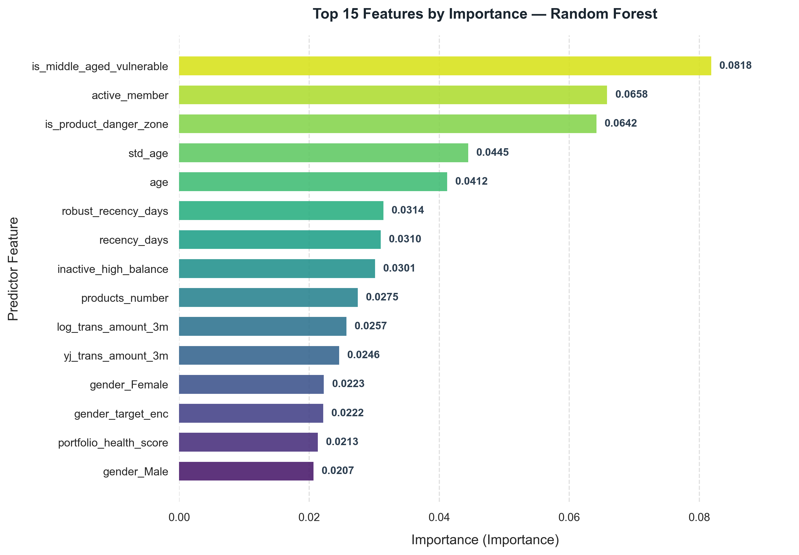
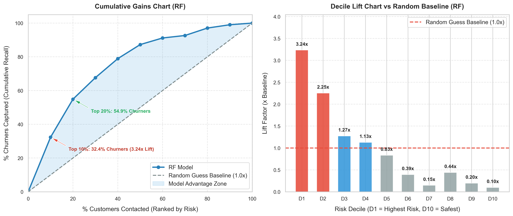

# BÁO CÁO HUẤN LUYỆN MÔ HÌNH RANDOM FOREST (TRAINING REPORT)
## DỰ BÁO RỦI RO RỜI BỎ KHÁCH HÀNG (CUSTOMER CHURN PREDICTION)

**Thời gian huấn luyện:** `2026-11-05 00:30:21`  
**Mô hình:** `Random Forest`  
**Artifact đã lưu:** `models/saved/rf_churn.pkl`  
**Cấu hình:** [`config/config.yaml`](../config/config.yaml)  

---

## 1. KẾT QUẢ ĐÁNH GIÁ TRÊN TẬP TEST

| Metric            | Value      |
|:------------------|:-----------|
| ROC_AUC           | 0.8213     |
| PR_AUC            | 0.5760     |
| F1_Score          | 0.5469     |
| Precision         | 0.5833     |
| Recall            | 0.5147     |
| Accuracy          | 0.8260     |
| Balanced_Accuracy | 0.7102     |
| Log_Loss          | 0.4265     |
| TP                | 105        |
| FP                | 75         |
| TN                | 721        |
| FN                | 99         |
| Experiment        | Single Run |
| Model             | RF         |
| Num_Features      | 133        |
| X_val_Shape       | 1001x133   |
| SMOTE_Applied     | True       |

---

## 2. MA TRẬN NHẦM LẪN (CONFUSION MATRIX)

- **True Positives (TP - Bắt đúng khách hàng rời bỏ):** `105`
- **False Negatives (FN - Bỏ sót khách hàng rời bỏ):** `99`
- **True Negatives (TN - Nhận diện đúng khách hàng ở lại):** `721`
- **False Positives (FP - Cảnh báo nhầm khách hàng ở lại):** `75`

---

## 3. TOP 15 ĐẶC TRƯNG QUAN TRỌNG NHẤT

| Feature                   |   Importance |   Relative_Pct |
|:--------------------------|-------------:|---------------:|
| is_middle_aged_vulnerable |    0.0818242 |           8.18 |
| active_member             |    0.0658239 |           6.58 |
| is_product_danger_zone    |    0.0641675 |           6.42 |
| std_age                   |    0.0444694 |           4.45 |
| age                       |    0.0412084 |           4.12 |
| robust_recency_days       |    0.0314123 |           3.14 |
| recency_days              |    0.0309913 |           3.1  |
| inactive_high_balance     |    0.0301461 |           3.01 |
| products_number           |    0.0274579 |           2.75 |
| log_trans_amount_3m       |    0.0257411 |           2.57 |
| yj_trans_amount_3m        |    0.0246154 |           2.46 |
| gender_Female             |    0.0222642 |           2.23 |
| gender_target_enc         |    0.0221636 |           2.22 |
| portfolio_health_score    |    0.0213275 |           2.13 |
| gender_Male               |    0.0206672 |           2.07 |

---

## 4. ĐÁNH GIÁ HỆ SỐ LIFT & 10 PHÂN VỊ RỦI RO (DECILE LIFT & GAINS)

### 4.1. Bảng 10 phân vị rủi ro (Decile Lift Analysis):
* **Top 10% rủi ro cao nhất (Decile D1):** Đạt hệ số **Lift 3.24x** so với chọn ngẫu nhiên.
* **Top 20% rủi ro cao nhất (Decile D1 + D2):** Đạt hệ số **Cumulative Lift 2.75x**.

| Decile   |   Customers |   Churners | Churn_Rate   | Decile_Lift   | Cum_Recall   | Cum_Lift   |
|:---------|------------:|-----------:|:-------------|:--------------|:-------------|:-----------|
| D1       |         100 |         66 | 66.00%       | 3.24x         | 32.35%       | 3.24x      |
| D2       |         100 |         46 | 46.00%       | 2.25x         | 54.90%       | 2.75x      |
| D3       |         100 |         26 | 26.00%       | 1.27x         | 67.65%       | 2.25x      |
| D4       |         100 |         23 | 23.00%       | 1.13x         | 78.92%       | 1.97x      |
| D5       |         100 |         17 | 17.00%       | 0.83x         | 87.25%       | 1.75x      |
| D6       |         100 |          8 | 8.00%        | 0.39x         | 91.18%       | 1.52x      |
| D7       |         100 |          3 | 3.00%        | 0.15x         | 92.65%       | 1.32x      |
| D8       |         100 |          9 | 9.00%        | 0.44x         | 97.06%       | 1.21x      |
| D9       |         100 |          4 | 4.00%        | 0.20x         | 99.02%       | 1.10x      |
| D10      |         100 |          2 | 2.00%        | 0.10x         | 100.00%      | 1.00x      |

### 4.2. So sánh với các Baselines & Điểm vận hành tối ưu:
| Configuration                              | Threshold   | Accuracy   | Precision   | Recall   |   F1_Score |   ROC_AUC |   PR_AUC | Precision_Lift   | Recall_Lift   | PR_AUC_Lift   |
|:-------------------------------------------|:------------|:-----------|:------------|:---------|-----------:|----------:|---------:|:-----------------|:--------------|:--------------|
| 1. Random Guess Baseline                   | -           | 67.52%     | 20.40%      | 20.40%   |     0.204  |    0.5    |    0.204 | 1.00x            | 1.00x         | 1.00x         |
| 2. Majority Class Baseline (All Non-Churn) | 1.00        | 79.60%     | 0.00%       | 0.00%    |     0      |    0.5    |    0.204 | 0.00x            | 0.00x         | 1.00x         |
| Model @ Default (0.50)                     | 0.50        | 82.60%     | 58.33%      | 51.47%   |     0.5469 |    0.8213 |    0.576 | 2.86x            | 2.52x         | 2.82x         |
| Model @ Optimal F1                         | 0.33        | 74.10%     | 42.38%      | 75.00%   |     0.5416 |    0.8213 |    0.576 | 2.08x            | 3.68x         | 2.82x         |
| Model @ Optimal F2 (High Recall)           | 0.28        | 69.90%     | 38.85%      | 82.84%   |     0.529  |    0.8213 |    0.576 | 1.90x            | 4.06x         | 2.82x         |
| Model @ Target Recall (>=75%)              | 0.30        | 71.80%     | 40.25%      | 78.92%   |     0.5331 |    0.8213 |    0.576 | 1.97x            | 3.87x         | 2.82x         |

---
*Báo cáo được sinh tự động bởi hệ thống Digital Bank Churn Prediction Pipeline — Module 5: Model Development.*
