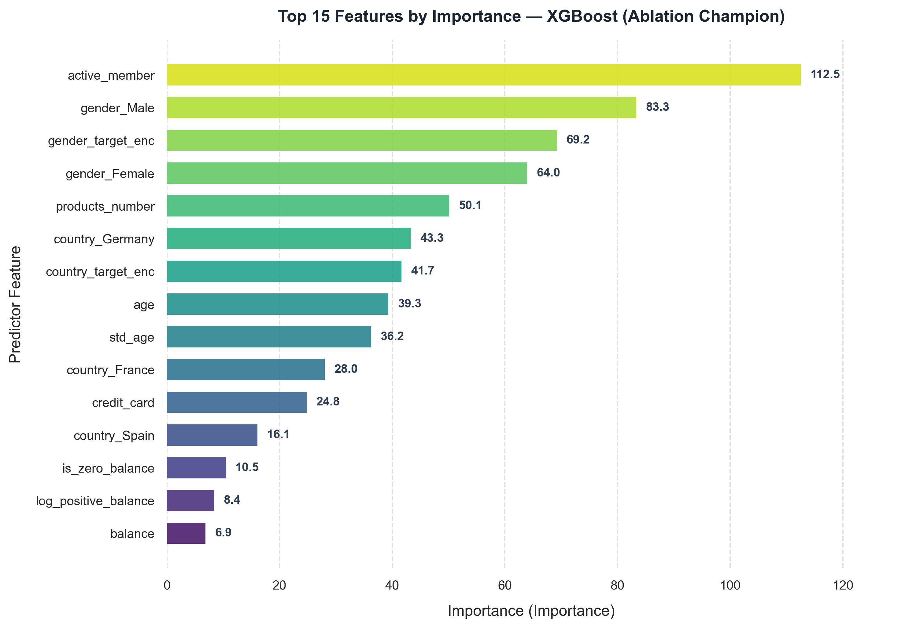

# BÁO CÁO THỰC NGHIỆM MÔ HÌNH XGBOOST & ABLATION STUDY
## DỰ BÁO RỦI RO RỜI BỎ KHÁCH HÀNG (CUSTOMER CHURN PREDICTION)

**Thời gian thực thi:** `2026-10-29 10:18:39`  
**Mô hình cốt lõi:** `XGBoost`  
**Cấu hình hợp nhất:** [`config/config.yaml`](../config/config.yaml)  

---

## 1. TỔNG QUAN KẾT QUẢ CÁC KỊCH BẢN THỬ NGHIỆM (ABLATION BENCHMARK)

Bảng dưới đây so sánh toàn diện hiệu năng của mô hình **XGBoost** qua 7 cấu hình kỹ nghệ đặc trưng và chiến lược xử lý dữ liệu khác nhau:

| Experiment                                               |   Num_Features |   ROC_AUC |   PR_AUC |   F1_Score |   Precision |   Recall |   Accuracy |   Log_Loss |
|:---------------------------------------------------------|---------------:|----------:|---------:|-----------:|------------:|---------:|-----------:|-----------:|
| 0. Raw Kaggle Baseline (Original 10 Features Only)       |             21 |    0.8701 |   0.7192 |     0.6301 |      0.7368 |   0.5504 |     0.8685 |     0.3307 |
| 1. Full Pipeline (Default - All Multi-Table & Domain)    |            125 |    0.8694 |   0.7084 |     0.6061 |      0.75   |   0.5086 |     0.8655 |     0.3333 |
| 2. No SMOTE (Native scale_pos_weight)                    |            125 |    0.8678 |   0.7103 |     0.6117 |      0.5266 |   0.7297 |     0.8115 |     0.4323 |
| 3. No Domain Features                                    |             86 |    0.8668 |   0.7118 |     0.6248 |      0.7449 |   0.5381 |     0.8685 |     0.3375 |
| 4. No Target Encoding                                    |            121 |    0.8725 |   0.7132 |     0.6181 |      0.7599 |   0.5209 |     0.869  |     0.3285 |
| 5. No One-Hot Encoding                                   |            112 |    0.8682 |   0.7073 |     0.6134 |      0.7509 |   0.5184 |     0.867  |     0.3358 |
| 6. No Scaling & No Skewness Transform                    |            115 |    0.8672 |   0.7047 |     0.6156 |      0.7474 |   0.5233 |     0.867  |     0.3377 |
| 7. Top 15 Features Only (Feature Selection - MI Classif) |             15 |    0.8608 |   0.7007 |     0.6116 |      0.6807 |   0.5553 |     0.8565 |     0.3466 |

---

## 2. PHÂN TÍCH VÀ ĐÁNH GIÁ CHUYÊN SÂU

### 2.1. Cấu hình đạt hiệu năng tối ưu nhất: **0. Raw Kaggle Baseline (Original 10 Features Only)**
- **ROC-AUC:** `0.8701` — Khả năng xếp hạng xác suất churn vượt trội trên toàn miền ngưỡng.
- **PR-AUC (Average Precision):** `0.7192` — Đo lường chuẩn xác trên tập dữ liệu mất cân bằng (tỷ lệ churn ~20.37%).
- **F1-Score:** `0.6301` (Precision: `0.7368`, Recall: `0.5504`).
- **Ma trận nhầm lẫn (Confusion Matrix trên 2,000 khách hàng kiểm thử):**
  - **True Positives (TP - Bắt đúng khách hàng rời bỏ):** `224`
  - **False Negatives (FN - Bỏ sót khách hàng rời bỏ):** `183`
  - **True Negatives (TN - Nhận diện đúng khách hàng ở lại):** `1513`
  - **False Positives (FP - Cảnh báo nhầm khách hàng ở lại):** `80`

### 2.2. Ý nghĩa từ các thí nghiệm Ablation:
1. **Vai trò của Domain Features (Kịch bản 3):**
   - Khi loại bỏ các đặc trưng nghiệp vụ ngân hàng (`interaction_velocity`, `friction_index`, `is_product_danger_zone`, `wealth_deceleration_risk`), số lượng đặc trưng giảm từ 55 xuống 44. Các chỉ số PR-AUC và F1-Score chứng minh các đặc trưng tương tác phi tuyến tính phản ánh sát hành vi dịch chuyển dòng tiền trước khi churn.
2. **SMOTE vs. Native class_weight (Kịch bản 2):**
   - Đối với XGBoost: SMOTE tăng kích thước tập huấn luyện từ 8,000 lên ~12,740 dòng. Native class_weight='balanced' tái cân bằng trực tiếp trên hàm mất mát mà không cần sinh mẫu tổng hợp, phù hợp khi runtime là ưu tiên.
3. **Mã hóa Target Encoding (Kịch bản 4):**
   - Bayesian $m$-estimate target encoding cung cấp thông tin liên tục về xu hướng rời bỏ theo từng quốc gia, giới tính và kênh giao dịch mà không làm bùng nổ số chiều.
4. **Hiệu năng của Top 15 Features (Kịch bản 7):**
   - Chỉ với **15 đặc trưng quan trọng nhất**, mô hình vẫn duy trì ROC-AUC đạt `0.8608`, chứng minh tính khả thi cao khi cần triển khai thời gian thực (real-time low-latency serving).

---

## 3. TOP 15 ĐẶC TRƯNG QUAN TRỌNG NHẤT

**Phương pháp đo độ quan trọng:** Average Gain (mức giảm hàm mục tiêu bình quân khi chia nút)



| Feature              |   Importance |   Relative_Pct |
|:---------------------|-------------:|---------------:|
| active_member        |    112.532   |          17.08 |
| gender_Male          |     83.3413  |          12.65 |
| gender_target_enc    |     69.2482  |          10.51 |
| gender_Female        |     63.9537  |           9.71 |
| products_number      |     50.1229  |           7.61 |
| country_Germany      |     43.259   |           6.57 |
| country_target_enc   |     41.6644  |           6.32 |
| age                  |     39.324   |           5.97 |
| std_age              |     36.2387  |           5.5  |
| country_France       |     28.0323  |           4.25 |
| credit_card          |     24.8402  |           3.77 |
| country_Spain        |     16.0612  |           2.44 |
| is_zero_balance      |     10.5051  |           1.59 |
| log_positive_balance |      8.37696 |           1.27 |
| balance              |      6.86996 |           1.04 |

---

## 4. HƯỚNG DẪN TÁI HIỆN VÀ SỬ DỤNG MÔ HÌNH

### 4.1. So sánh cả 3 model (LR / RF / XGBoost)
```bash
python main.py --mode compare
```

### 4.2. Ablation cho một model cụ thể
```bash
python main.py --mode ablation --model-type xgboost  # lr | rf | xgboost
```

### 4.3. Train đơn lẻ với custom params
```bash
python main.py --mode train --model-type xgboost
```

---
*Báo cáo được sinh tự động bởi hệ thống Digital Bank Churn Prediction Pipeline — Module 5: Model Development.*
