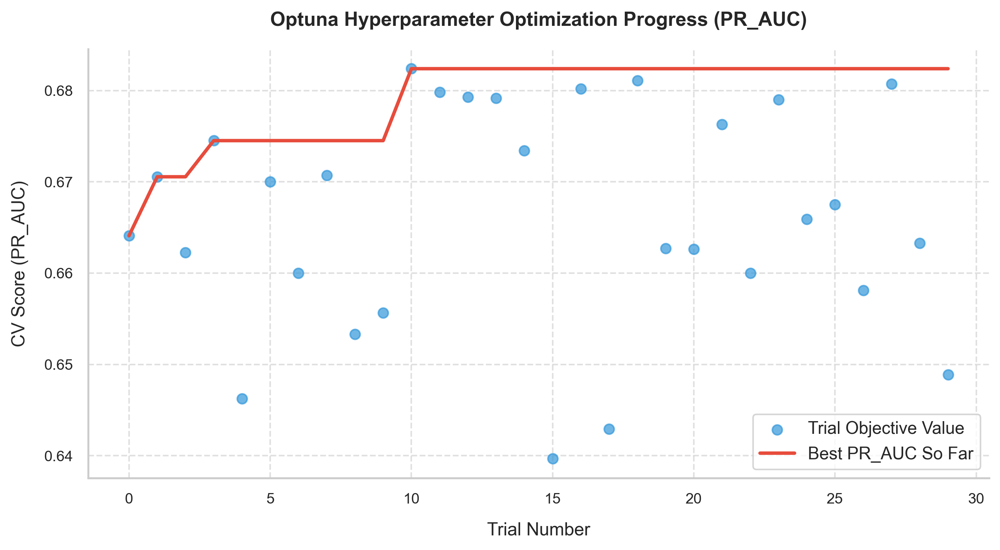

# BÁO CÁO TỐI ƯU HÓA SIÊU THAM SỐ (OPTUNA TUNING REPORT)
## MÔ HÌNH: XGBOOST CHURN PREDICTION

**Thời gian thực hiện:** `2026-11-19 23:44:59`  
**Mục tiêu tối ưu:** `PR_AUC` (Cross-Validation Folds: `5`)  
**Tổng số trials:** `30` (Hoàn thành: `17`, Cắt tỉa sớm - Pruned: `13`)  
**CV Score cao nhất (PR_AUC):** `0.6824`  

---

## 1. TIẾN TRÌNH TỐI ƯU HÓA (OPTIMIZATION PROGRESS)

---

## 2. BỘ SIÊU THAM SỐ TỐI ƯU (BEST HYPERPARAMETERS)

| Hyperparameter   |   Optimal Value |
|:-----------------|----------------:|
| n_estimators     |     250         |
| max_depth        |       3         |
| learning_rate    |       0.108506  |
| subsample        |       1         |
| colsample_bytree |       0.9       |
| gamma            |       0.8       |
| min_child_weight |       1         |
| reg_alpha        |       0.075187  |
| reg_lambda       |       0.0164413 |

---

## 3. HIỆU NĂNG ĐÁNH GIÁ TRÊN TẬP TEST ĐỘC LẬP (GENERALIZATION TEST SET)

Được đánh giá trên tập kiểm thử độc lập (20% dữ liệu) hoàn toàn không rò rỉ trong quá trình tuning:

| Metric            |   Score |
|:------------------|--------:|
| ROC_AUC           |  0.8442 |
| PR_AUC            |  0.6665 |
| F1_Score          |  0.5791 |
| Precision         |  0.5749 |
| Recall            |  0.5833 |
| Accuracy          |  0.827  |
| Balanced_Accuracy |  0.7364 |
| Log_Loss          |  0.3621 |

### Ma trận nhầm lẫn (Confusion Matrix):
- **True Positives (Bắt đúng churn):** `119`
- **False Negatives (Bỏ sót churn):** `85`
- **True Negatives (Khách hàng ở lại):** `708`
- **False Positives (Báo nhầm churn):** `88`

---

## 4. TOP 15 ĐẶC TRƯNG QUAN TRỌNG NHẤT (TUNED MODEL)

| Feature                                 |   Importance |   Relative_Pct |
|:----------------------------------------|-------------:|---------------:|
| lda_projection_churn                    |     115.319  |           4.65 |
| lda_prob_churn                          |      87.3778 |           3.53 |
| quant_multiscale_outflow_14d            |      41.5838 |           1.68 |
| quant_volatility_net_flow_cv            |      30.5443 |           1.23 |
| trans_trend_ratio                       |      30.1458 |           1.22 |
| cluster_second_min_dist                 |      27.5642 |           1.11 |
| cluster_dist_1                          |      25.1393 |           1.01 |
| quant_inter_germany_x_age               |      24.1251 |           0.97 |
| quant_multiscale_avg_ticket_size_90d    |      20.8478 |           0.84 |
| quant_multiscale_login_failed_count_14d |      20.673  |           0.83 |
| quant_multiscale_login_count_60d        |      20.0608 |           0.81 |
| quant_rolling_mean_3m_login_days        |      19.6609 |           0.79 |
| germany_high_balance                    |      19.3547 |           0.78 |
| robust_trans_trend_ratio                |      19.2491 |           0.78 |
| balance                                 |      18.3546 |           0.74 |

---

## 5. ĐÁNH GIÁ HỆ SỐ LIFT & 10 PHÂN VỊ RỦI RO (DECILE LIFT & GAINS)

### 5.1. Bảng 10 phân vị rủi ro (Decile Lift Analysis):
* **Top 10% rủi ro cao nhất (Decile D1):** Đạt hệ số **Lift 3.87x** so với chọn ngẫu nhiên.
* **Top 20% rủi ro cao nhất (Decile D1 + D2):** Đạt hệ số **Cumulative Lift 2.89x**.

| Decile   |   Customers |   Churners | Churn_Rate   | Decile_Lift   | Cum_Recall   | Cum_Lift   |
|:---------|------------:|-----------:|:-------------|:--------------|:-------------|:-----------|
| D1       |         100 |         79 | 79.00%       | 3.87x         | 38.73%       | 3.87x      |
| D2       |         100 |         39 | 39.00%       | 1.91x         | 57.84%       | 2.89x      |
| D3       |         100 |         33 | 33.00%       | 1.62x         | 74.02%       | 2.47x      |
| D4       |         100 |         13 | 13.00%       | 0.64x         | 80.39%       | 2.01x      |
| D5       |         100 |         14 | 14.00%       | 0.69x         | 87.25%       | 1.75x      |
| D6       |         100 |         10 | 10.00%       | 0.49x         | 92.16%       | 1.54x      |
| D7       |         100 |          6 | 6.00%        | 0.29x         | 95.10%       | 1.36x      |
| D8       |         100 |          6 | 6.00%        | 0.29x         | 98.04%       | 1.23x      |
| D9       |         100 |          2 | 2.00%        | 0.10x         | 99.02%       | 1.10x      |
| D10      |         100 |          2 | 2.00%        | 0.10x         | 100.00%      | 1.00x      |

### 5.2. So sánh với các Baselines & Điểm vận hành tối ưu:
| Configuration                              | Threshold   | Accuracy   | Precision   | Recall   |   F1_Score |   ROC_AUC |   PR_AUC | Precision_Lift   | Recall_Lift   | PR_AUC_Lift   |
|:-------------------------------------------|:------------|:-----------|:------------|:---------|-----------:|----------:|---------:|:-----------------|:--------------|:--------------|
| 1. Random Guess Baseline                   | -           | 67.52%     | 20.40%      | 20.40%   |     0.204  |    0.5    |   0.204  | 1.00x            | 1.00x         | 1.00x         |
| 2. Majority Class Baseline (All Non-Churn) | 1.00        | 79.60%     | 0.00%       | 0.00%    |     0      |    0.5    |   0.204  | 0.00x            | 0.00x         | 1.00x         |
| Model @ Default (0.50)                     | 0.50        | 85.90%     | 72.34%      | 50.00%   |     0.5913 |    0.8442 |   0.6665 | 3.55x            | 2.45x         | 3.27x         |
| Model @ Optimal F1                         | 0.28        | 81.30%     | 53.44%      | 64.71%   |     0.5854 |    0.8442 |   0.6665 | 2.62x            | 3.17x         | 3.27x         |
| Model @ Optimal F2 (High Recall)           | 0.13        | 73.50%     | 42.08%      | 79.41%   |     0.5501 |    0.8442 |   0.6665 | 2.06x            | 3.89x         | 3.27x         |
| Model @ Target Recall (>=75%)              | 0.31        | 81.50%     | 54.11%      | 61.27%   |     0.5747 |    0.8442 |   0.6665 | 2.65x            | 3.00x         | 3.27x         |
| Model @ Manual (0.35)                      | 0.35        | 82.70%     | 57.49%      | 58.33%   |     0.5791 |    0.8442 |   0.6665 | 2.82x            | 2.86x         | 3.27x         |

---
*Báo cáo được sinh tự động bởi Optuna Tuner Engine - Digital Bank Churn Prediction.*
