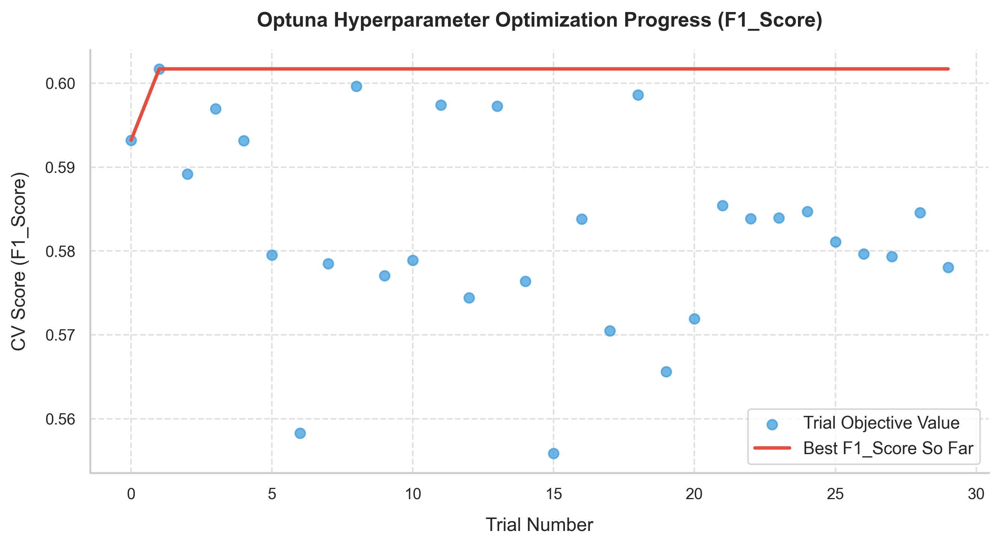
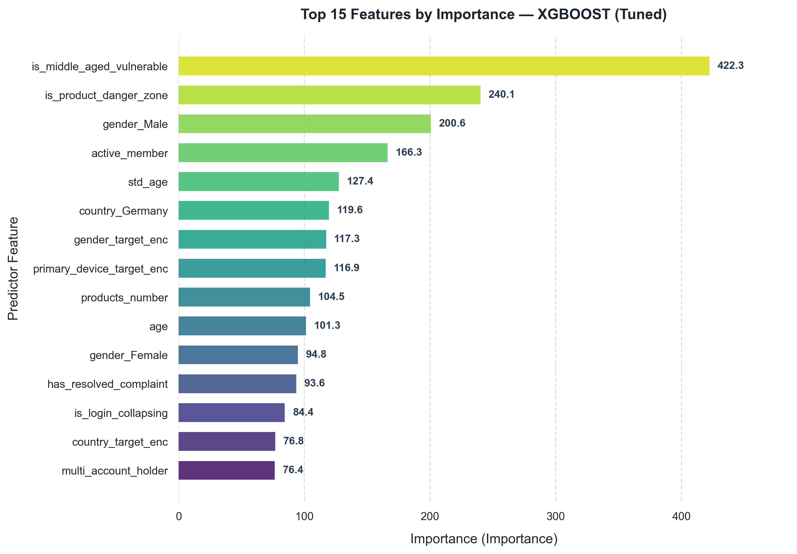
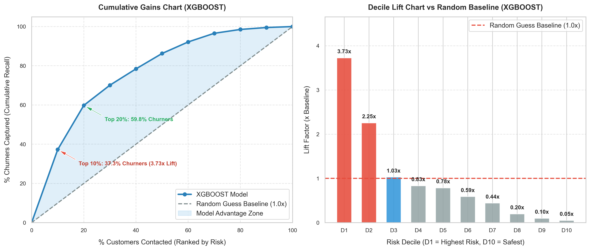

# BÁO CÁO TỐI ƯU HÓA SIÊU THAM SỐ (OPTUNA TUNING REPORT)
## MÔ HÌNH: XGBOOST CHURN PREDICTION

**Thời gian thực hiện:** `2026-11-04 23:59:11`  
**Mục tiêu tối ưu:** `F1_Score` (Cross-Validation Folds: `5`)  
**Tổng số trials:** `30` (Hoàn thành: `9`, Cắt tỉa sớm - Pruned: `21`)  
**CV Score cao nhất (F1_Score):** `0.6017`  

---

## 1. TIẾN TRÌNH TỐI ƯU HÓA (OPTIMIZATION PROGRESS)

---

## 2. BỘ SIÊU THAM SỐ TỐI ƯU (BEST HYPERPARAMETERS)

| Hyperparameter   |   Optimal Value |
|:-----------------|----------------:|
| n_estimators     |    400          |
| max_depth        |      6          |
| learning_rate    |      0.0764083  |
| subsample        |      1          |
| colsample_bytree |      0.7        |
| gamma            |      3          |
| min_child_weight |      4          |
| reg_alpha        |      0.00571509 |
| reg_lambda       |      4.72601    |

---

## 3. HIỆU NĂNG ĐÁNH GIÁ TRÊN TẬP TEST ĐỘC LẬP (GENERALIZATION TEST SET)

Được đánh giá trên tập kiểm thử độc lập (20% dữ liệu) hoàn toàn không rò rỉ trong quá trình tuning:

| Metric            |   Score |
|:------------------|--------:|
| ROC_AUC           |  0.8704 |
| PR_AUC            |  0.6922 |
| F1_Score          |  0.5799 |
| Precision         |  0.7313 |
| Recall            |  0.4804 |
| Accuracy          |  0.858  |
| Balanced_Accuracy |  0.7176 |
| Log_Loss          |  0.3393 |

### Ma trận nhầm lẫn (Confusion Matrix):
- **True Positives (Bắt đúng churn):** `98`
- **False Negatives (Bỏ sót churn):** `106`
- **True Negatives (Khách hàng ở lại):** `760`
- **False Positives (Báo nhầm churn):** `36`

---

## 4. TOP 15 ĐẶC TRƯNG QUAN TRỌNG NHẤT (TUNED MODEL)

| Feature                     |   Importance |   Relative_Pct |
|:----------------------------|-------------:|---------------:|
| is_middle_aged_vulnerable   |     491.6    |          19.21 |
| is_product_danger_zone      |     171.102  |           6.68 |
| active_member               |     141.028  |           5.51 |
| gender_Male                 |     127.513  |           4.98 |
| gender_target_enc           |      71.5381 |           2.79 |
| products_number             |      67.3281 |           2.63 |
| avg_early_withdrawal_rate   |      65.4458 |           2.56 |
| std_age                     |      53.9842 |           2.11 |
| country_Germany             |      52.0456 |           2.03 |
| has_resolved_complaint      |      51.962  |           2.03 |
| has_savings_account         |      48.6328 |           1.9  |
| unresolved_complaints_count |      45.8425 |           1.79 |
| inactive_high_balance       |      45.4385 |           1.78 |
| age                         |      44.3648 |           1.73 |
| multi_account_holder        |      43.8656 |           1.71 |

---

## 5. ĐÁNH GIÁ HỆ SỐ LIFT & 10 PHÂN VỊ RỦI RO (DECILE LIFT & GAINS)

### 5.1. Bảng 10 phân vị rủi ro (Decile Lift Analysis):
* **Top 10% rủi ro cao nhất (Decile D1):** Đạt hệ số **Lift 3.77x** so với chọn ngẫu nhiên.
* **Top 20% rủi ro cao nhất (Decile D1 + D2):** Đạt hệ số **Cumulative Lift 3.06x**.

| Decile   |   Customers |   Churners | Churn_Rate   | Decile_Lift   | Cum_Recall   | Cum_Lift   |
|:---------|------------:|-----------:|:-------------|:--------------|:-------------|:-----------|
| D1       |         100 |         77 | 77.00%       | 3.77x         | 37.75%       | 3.77x      |
| D2       |         100 |         48 | 48.00%       | 2.35x         | 61.27%       | 3.06x      |
| D3       |         100 |         29 | 29.00%       | 1.42x         | 75.49%       | 2.52x      |
| D4       |         100 |         20 | 20.00%       | 0.98x         | 85.29%       | 2.13x      |
| D5       |         100 |          9 | 9.00%        | 0.44x         | 89.71%       | 1.79x      |
| D6       |         100 |         11 | 11.00%       | 0.54x         | 95.10%       | 1.58x      |
| D7       |         100 |          4 | 4.00%        | 0.20x         | 97.06%       | 1.39x      |
| D8       |         100 |          3 | 3.00%        | 0.15x         | 98.53%       | 1.23x      |
| D9       |         100 |          2 | 2.00%        | 0.10x         | 99.51%       | 1.11x      |
| D10      |         100 |          1 | 1.00%        | 0.05x         | 100.00%      | 1.00x      |

### 5.2. So sánh với các Baselines & Điểm vận hành tối ưu:
| Configuration                              | Threshold   | Accuracy   | Precision   | Recall   |   F1_Score |   ROC_AUC |   PR_AUC | Precision_Lift   | Recall_Lift   | PR_AUC_Lift   |
|:-------------------------------------------|:------------|:-----------|:------------|:---------|-----------:|----------:|---------:|:-----------------|:--------------|:--------------|
| 1. Random Guess Baseline                   | -           | 67.52%     | 20.40%      | 20.40%   |     0.204  |    0.5    |   0.204  | 1.00x            | 1.00x         | 1.00x         |
| 2. Majority Class Baseline (All Non-Churn) | 1.00        | 79.60%     | 0.00%       | 0.00%    |     0      |    0.5    |   0.204  | 0.00x            | 0.00x         | 1.00x         |
| Model @ Default (0.50)                     | 0.50        | 85.80%     | 73.13%      | 48.04%   |     0.5799 |    0.8704 |   0.6922 | 3.59x            | 2.35x         | 3.39x         |
| Model @ Optimal F1                         | 0.39        | 85.40%     | 65.26%      | 60.78%   |     0.6294 |    0.8704 |   0.6922 | 3.20x            | 2.98x         | 3.39x         |
| Model @ Optimal F2 (High Recall)           | 0.16        | 74.70%     | 43.83%      | 85.29%   |     0.579  |    0.8704 |   0.6922 | 2.15x            | 4.18x         | 3.39x         |
| Model @ Target Recall (>=75%)              | 0.22        | 79.70%     | 50.16%      | 76.96%   |     0.6074 |    0.8704 |   0.6922 | 2.46x            | 3.77x         | 3.39x         |

---
*Báo cáo được sinh tự động bởi Optuna Tuner Engine - Digital Bank Churn Prediction.*
