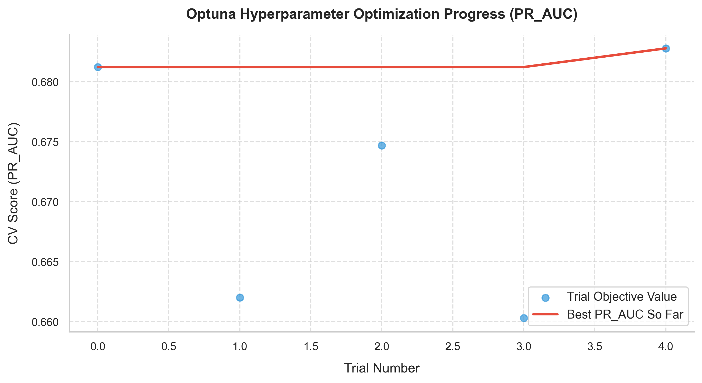
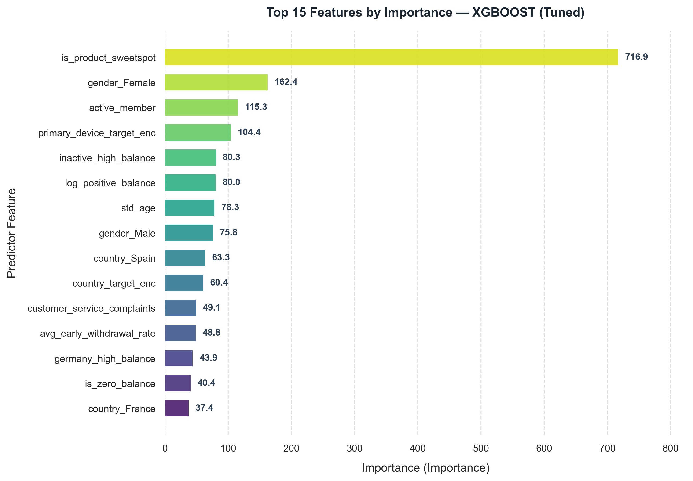

# BÁO CÁO TỐI ƯU HÓA SIÊU THAM SỐ (OPTUNA TUNING REPORT)
## MÔ HÌNH: XGBOOST CHURN PREDICTION

**Thời gian thực hiện:** `2026-10-24 00:24:24`  
**Mục tiêu tối ưu:** `PR_AUC` (Cross-Validation Folds: `5`)  
**Tổng số trials:** `5` (Hoàn thành: `5`, Cắt tỉa sớm - Pruned: `0`)  
**CV Score cao nhất (PR_AUC):** `0.6828`  

---

## 1. TIẾN TRÌNH TỐI ƯU HÓA (OPTIMIZATION PROGRESS)

---

## 2. BỘ SIÊU THAM SỐ TỐI ƯU (BEST HYPERPARAMETERS)

| Hyperparameter   |   Optimal Value |
|:-----------------|----------------:|
| n_estimators     |      300        |
| max_depth        |        5        |
| learning_rate    |        0.152869 |
| subsample        |        1        |
| colsample_bytree |        1        |
| gamma            |        1.8      |
| min_child_weight |        1        |
| reg_alpha        |        2.82678  |
| reg_lambda       |        0.016893 |

---

## 3. HIỆU NĂNG ĐÁNH GIÁ TRÊN TẬP TEST ĐỘC LẬP (GENERALIZATION TEST SET)

Được đánh giá trên tập kiểm thử độc lập (20% dữ liệu) hoàn toàn không rò rỉ trong quá trình tuning:

| Metric            |   Score |
|:------------------|--------:|
| ROC_AUC           |  0.8629 |
| PR_AUC            |  0.7071 |
| F1_Score          |  0.6162 |
| Precision         |  0.7    |
| Recall            |  0.5504 |
| Accuracy          |  0.8605 |
| Balanced_Accuracy |  0.7451 |
| Log_Loss          |  0.3393 |

### Ma trận nhầm lẫn (Confusion Matrix):
- **True Positives (Bắt đúng churn):** `224`
- **False Negatives (Bỏ sót churn):** `183`
- **True Negatives (Khách hàng ở lại):** `1497`
- **False Positives (Báo nhầm churn):** `96`

---

## 4. TOP 15 ĐẶC TRƯNG QUAN TRỌNG NHẤT (TUNED MODEL)

| Feature                     |   Importance |   Relative_Pct |
|:----------------------------|-------------:|---------------:|
| is_product_sweetspot        |     716.878  |          28.06 |
| gender_Female               |     162.368  |           6.36 |
| active_member               |     115.335  |           4.52 |
| primary_device_target_enc   |     104.415  |           4.09 |
| inactive_high_balance       |      80.2847 |           3.14 |
| log_positive_balance        |      79.9954 |           3.13 |
| std_age                     |      78.3482 |           3.07 |
| gender_Male                 |      75.8302 |           2.97 |
| country_Spain               |      63.3035 |           2.48 |
| country_target_enc          |      60.4297 |           2.37 |
| customer_service_complaints |      49.1128 |           1.92 |
| avg_early_withdrawal_rate   |      48.7733 |           1.91 |
| germany_high_balance        |      43.9079 |           1.72 |
| is_zero_balance             |      40.41   |           1.58 |
| country_France              |      37.3967 |           1.46 |

---
*Báo cáo được sinh tự động bởi Optuna Tuner Engine — Digital Bank Churn Prediction.*
