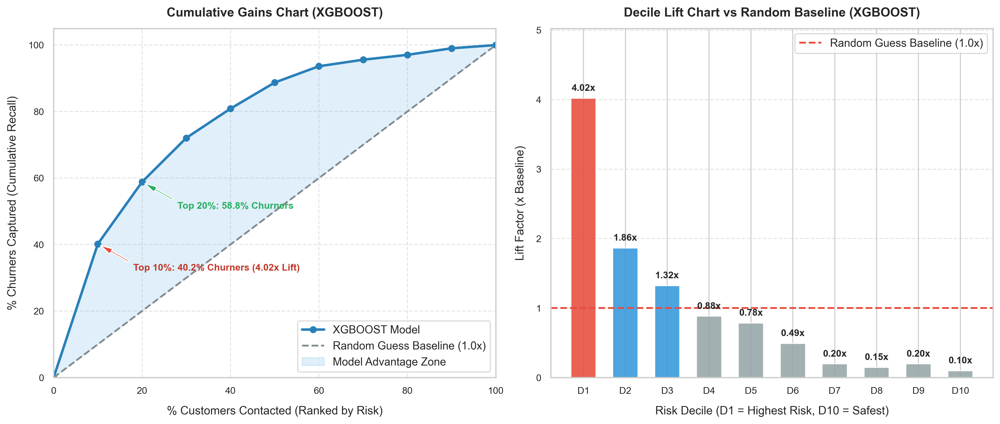

# BÁO CÁO TỐI ƯU HÓA SIÊU THAM SỐ (OPTUNA TUNING REPORT)
## MÔ HÌNH: XGBOOST CHURN PREDICTION

**Thời gian thực hiện:** `2026-11-24 21:10:08`  
**Mục tiêu tối ưu:** `PR_AUC` (Cross-Validation Folds: `10`)  
**Tổng số trials:** `30` (Hoàn thành: `30`, Cắt tỉa sớm - Pruned: `0`)  
**CV Score cao nhất (PR_AUC):** `0.6899`  

---

## 1. TIẾN TRÌNH TỐI ƯU HÓA (OPTIMIZATION PROGRESS)

---

## 2. BỘ SIÊU THAM SỐ TỐI ƯU (BEST HYPERPARAMETERS)

| Hyperparameter   |   Optimal Value |
|:-----------------|----------------:|
| n_estimators     |     150         |
| max_depth        |       8         |
| learning_rate    |       0.0502704 |
| subsample        |       0.9       |
| colsample_bytree |       0.7       |
| gamma            |       1.8       |
| min_child_weight |       6         |
| reg_alpha        |       0.0221002 |
| reg_lambda       |       0.0011594 |

---

## 3. HIỆU NĂNG ĐÁNH GIÁ TRÊN TẬP TEST ĐỘC LẬP (GENERALIZATION TEST SET)

Được đánh giá trên tập kiểm thử độc lập (1000 mẫu) hoàn toàn không rò rỉ trong quá trình tuning:

| Metric            |   Score |
|:------------------|--------:|
| ROC_AUC           |  0.8599 |
| PR_AUC            |  0.6955 |
| F1_Score          |  0.613  |
| Precision         |  0.6519 |
| Recall            |  0.5784 |
| Accuracy          |  0.851  |
| Balanced_Accuracy |  0.7496 |
| Log_Loss          |  0.3416 |

### Ma trận nhầm lẫn (Confusion Matrix):
- **True Positives (Bắt đúng churn):** `118`
- **False Negatives (Bỏ sót churn):** `86`
- **True Negatives (Khách hàng ở lại):** `733`
- **False Positives (Báo nhầm churn):** `63`

---

## 4. TOP 15 ĐẶC TRƯNG QUAN TRỌNG NHẤT (TUNED MODEL)

| Feature                                  |   Importance |   Relative_Pct |
|:-----------------------------------------|-------------:|---------------:|
| is_middle_aged_vulnerable                |     161.344  |           8.47 |
| products_number                          |      43.5083 |           2.28 |
| psych_financial_runway_months            |      28.5414 |           1.5  |
| age                                      |      25.2753 |           1.33 |
| std_age                                  |      19.7208 |           1.03 |
| germany_high_balance                     |      19.28   |           1.01 |
| country_Germany                          |      19.1261 |           1    |
| country_target_enc                       |      18.9929 |           1    |
| cluster_diff_psych_fee_retaliation_score |      16.7009 |           0.88 |
| gender_Male                              |      15.3375 |           0.8  |
| log_positive_balance                     |      15.2497 |           0.8  |
| active_member                            |      15.1826 |           0.8  |
| trans_count_3m                           |      14.7093 |           0.77 |
| cluster_risk_dist_diff                   |      14.69   |           0.77 |
| gender_target_enc                        |      14.3173 |           0.75 |

---

## 5. ĐÁNH GIÁ HỆ SỐ LIFT & 10 PHÂN VỊ RỦI RO (DECILE LIFT & GAINS)

### 5.1. Bảng 10 phân vị rủi ro (Decile Lift Analysis):
* **Top 10% rủi ro cao nhất (Decile D1):** Đạt hệ số **Lift 4.07x** so với chọn ngẫu nhiên.
* **Top 20% rủi ro cao nhất (Decile D1 + D2):** Đạt hệ số **Cumulative Lift 3.11x**.

| Decile   |   Customers |   Churners | Churn_Rate   | Decile_Lift   | Cum_Recall   | Cum_Lift   |
|:---------|------------:|-----------:|:-------------|:--------------|:-------------|:-----------|
| D1       |         100 |         83 | 83.00%       | 4.07x         | 40.69%       | 4.07x      |
| D2       |         100 |         44 | 44.00%       | 2.16x         | 62.25%       | 3.11x      |
| D3       |         100 |         22 | 22.00%       | 1.08x         | 73.04%       | 2.43x      |
| D4       |         100 |         21 | 21.00%       | 1.03x         | 83.33%       | 2.08x      |
| D5       |         100 |         12 | 12.00%       | 0.59x         | 89.22%       | 1.78x      |
| D6       |         100 |          7 | 7.00%        | 0.34x         | 92.65%       | 1.54x      |
| D7       |         100 |          9 | 9.00%        | 0.44x         | 97.06%       | 1.39x      |
| D8       |         100 |          0 | 0.00%        | 0.00x         | 97.06%       | 1.21x      |
| D9       |         100 |          2 | 2.00%        | 0.10x         | 98.04%       | 1.09x      |
| D10      |         100 |          4 | 4.00%        | 0.20x         | 100.00%      | 1.00x      |

### 5.2. So sánh với các Baselines & Điểm vận hành tối ưu:
| Configuration                              | Threshold   | Accuracy   | Precision   | Recall   |   F1_Score |   ROC_AUC |   PR_AUC | Precision_Lift   | Recall_Lift   | PR_AUC_Lift   |
|:-------------------------------------------|:------------|:-----------|:------------|:---------|-----------:|----------:|---------:|:-----------------|:--------------|:--------------|
| 1. Random Guess Baseline                   | -           | 67.52%     | 20.40%      | 20.40%   |     0.204  |    0.5    |   0.204  | 1.00x            | 1.00x         | 1.00x         |
| 2. Majority Class Baseline (All Non-Churn) | 1.00        | 79.60%     | 0.00%       | 0.00%    |     0      |    0.5    |   0.204  | 0.00x            | 0.00x         | 1.00x         |
| Model @ Default (0.50)                     | 0.50        | 86.20%     | 74.63%      | 49.02%   |     0.5917 |    0.8599 |   0.6955 | 3.66x            | 2.40x         | 3.41x         |
| Model @ Optimal F1                         | 0.27        | 84.00%     | 59.73%      | 66.18%   |     0.6279 |    0.8599 |   0.6955 | 2.93x            | 3.24x         | 3.41x         |
| Model @ Optimal F2 (High Recall)           | 0.20        | 80.80%     | 52.13%      | 72.06%   |     0.6049 |    0.8599 |   0.6955 | 2.56x            | 3.53x         | 3.41x         |
| Model @ Target Recall (>=75%)              | 0.36        | 85.20%     | 65.73%      | 57.35%   |     0.6126 |    0.8599 |   0.6955 | 3.22x            | 2.81x         | 3.41x         |
| Model @ Manual (0.35)                      | 0.35        | 85.10%     | 65.19%      | 57.84%   |     0.613  |    0.8599 |   0.6955 | 3.20x            | 2.84x         | 3.41x         |

---
*Báo cáo được sinh tự động bởi Optuna Tuner Engine - Digital Bank Churn Prediction.*
