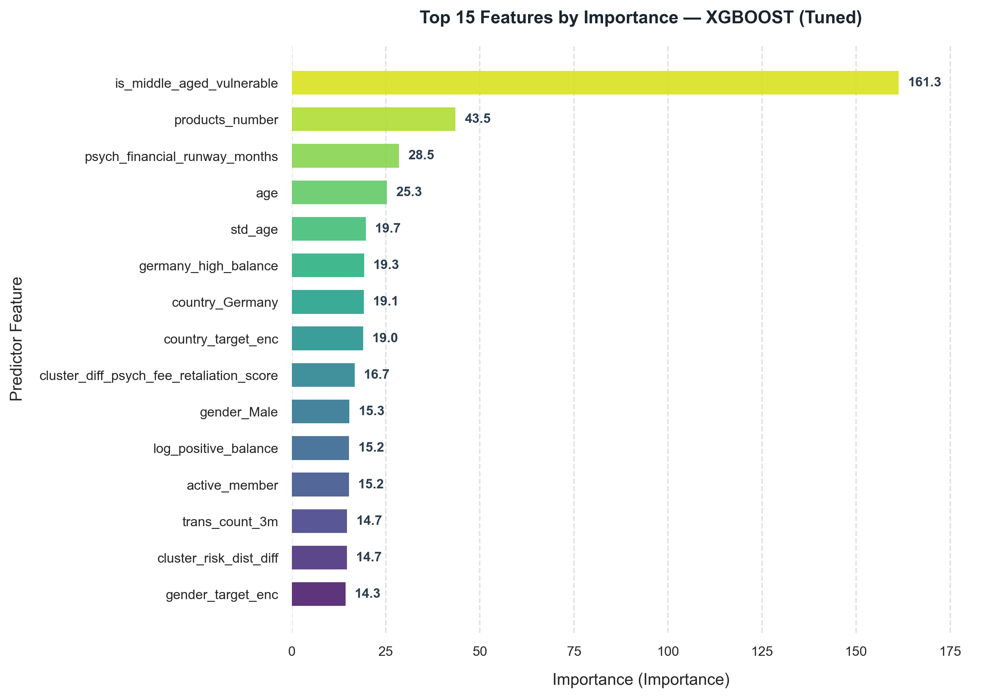

# BÁO CÁO TỐI ƯU HÓA SIÊU THAM SỐ (OPTUNA TUNING REPORT)
## MÔ HÌNH: XGBOOST CHURN PREDICTION

**Thời gian thực hiện:** `2026-11-17 14:04:41`  
**Mục tiêu tối ưu:** `PR_AUC` (Cross-Validation Folds: `5`)  
**Tổng số trials:** `30` (Hoàn thành: `17`, Cắt tỉa sớm - Pruned: `13`)  
**CV Score cao nhất (PR_AUC):** `0.6988`  

---

## 1. TIẾN TRÌNH TỐI ƯU HÓA (OPTIMIZATION PROGRESS)

---

## 2. BỘ SIÊU THAM SỐ TỐI ƯU (BEST HYPERPARAMETERS)

| Hyperparameter   |   Optimal Value |
|:-----------------|----------------:|
| n_estimators     |     400         |
| max_depth        |       4         |
| learning_rate    |       0.0736539 |
| subsample        |       1         |
| colsample_bytree |       0.6       |
| gamma            |       0.4       |
| min_child_weight |       6         |
| reg_alpha        |       0.0195406 |
| reg_lambda       |       0.101306  |

---

## 3. HIỆU NĂNG ĐÁNH GIÁ TRÊN TẬP TEST ĐỘC LẬP (GENERALIZATION TEST SET)

Được đánh giá trên tập kiểm thử độc lập (20% dữ liệu) hoàn toàn không rò rỉ trong quá trình tuning:

| Metric            |   Score |
|:------------------|--------:|
| ROC_AUC           |  0.8513 |
| PR_AUC            |  0.6813 |
| F1_Score          |  0.5772 |
| Precision         |  0.5969 |
| Recall            |  0.5588 |
| Accuracy          |  0.833  |
| Balanced_Accuracy |  0.731  |
| Log_Loss          |  0.3531 |

### Ma trận nhầm lẫn (Confusion Matrix):
- **True Positives (Bắt đúng churn):** `114`
- **False Negatives (Bỏ sót churn):** `90`
- **True Negatives (Khách hàng ở lại):** `719`
- **False Positives (Báo nhầm churn):** `77`

---

## 4. TOP 15 ĐẶC TRƯNG QUAN TRỌNG NHẤT (TUNED MODEL)

| Feature                           |   Importance |   Relative_Pct |
|:----------------------------------|-------------:|---------------:|
| is_middle_aged_vulnerable         |     229.974  |          13.35 |
| std_age                           |      48.2407 |           2.8  |
| quant_inter_age_x_danger_products |      39.6561 |           2.3  |
| products_number                   |      32.6744 |           1.9  |
| trans_count_3m                    |      30.7608 |           1.79 |
| quant_inter_products_x_inactive   |      27.5619 |           1.6  |
| quant_inter_age_x_products        |      27.0751 |           1.57 |
| quant_inter_germany_x_age         |      25.2842 |           1.47 |
| age                               |      22.0637 |           1.28 |
| quant_inter_germany_x_balance     |      16.0771 |           0.93 |
| quant_inter_age_x_inactive        |      15.9152 |           0.92 |
| robust_recency_days               |      15.1402 |           0.88 |
| wealth_deceleration_risk          |      15.1368 |           0.88 |
| quant_multiscale_inflow_30d       |      15.0751 |           0.88 |
| germany_high_balance              |      14.9874 |           0.87 |

---

## 5. ĐÁNH GIÁ HỆ SỐ LIFT & 10 PHÂN VỊ RỦI RO (DECILE LIFT & GAINS)

### 5.1. Bảng 10 phân vị rủi ro (Decile Lift Analysis):
* **Top 10% rủi ro cao nhất (Decile D1):** Đạt hệ số **Lift 4.02x** so với chọn ngẫu nhiên.
* **Top 20% rủi ro cao nhất (Decile D1 + D2):** Đạt hệ số **Cumulative Lift 2.94x**.

| Decile   |   Customers |   Churners | Churn_Rate   | Decile_Lift   | Cum_Recall   | Cum_Lift   |
|:---------|------------:|-----------:|:-------------|:--------------|:-------------|:-----------|
| D1       |         100 |         82 | 82.00%       | 4.02x         | 40.20%       | 4.02x      |
| D2       |         100 |         38 | 38.00%       | 1.86x         | 58.82%       | 2.94x      |
| D3       |         100 |         27 | 27.00%       | 1.32x         | 72.06%       | 2.40x      |
| D4       |         100 |         18 | 18.00%       | 0.88x         | 80.88%       | 2.02x      |
| D5       |         100 |         16 | 16.00%       | 0.78x         | 88.73%       | 1.77x      |
| D6       |         100 |         10 | 10.00%       | 0.49x         | 93.63%       | 1.56x      |
| D7       |         100 |          4 | 4.00%        | 0.20x         | 95.59%       | 1.37x      |
| D8       |         100 |          3 | 3.00%        | 0.15x         | 97.06%       | 1.21x      |
| D9       |         100 |          4 | 4.00%        | 0.20x         | 99.02%       | 1.10x      |
| D10      |         100 |          2 | 2.00%        | 0.10x         | 100.00%      | 1.00x      |

### 5.2. So sánh với các Baselines & Điểm vận hành tối ưu:
| Configuration                              | Threshold   | Accuracy   | Precision   | Recall   |   F1_Score |   ROC_AUC |   PR_AUC | Precision_Lift   | Recall_Lift   | PR_AUC_Lift   |
|:-------------------------------------------|:------------|:-----------|:------------|:---------|-----------:|----------:|---------:|:-----------------|:--------------|:--------------|
| 1. Random Guess Baseline                   | -           | 67.52%     | 20.40%      | 20.40%   |     0.204  |    0.5    |   0.204  | 1.00x            | 1.00x         | 1.00x         |
| 2. Majority Class Baseline (All Non-Churn) | 1.00        | 79.60%     | 0.00%       | 0.00%    |     0      |    0.5    |   0.204  | 0.00x            | 0.00x         | 1.00x         |
| Model @ Default (0.50)                     | 0.50        | 85.80%     | 73.48%      | 47.55%   |     0.5774 |    0.8513 |   0.6813 | 3.60x            | 2.33x         | 3.34x         |
| Model @ Optimal F1                         | 0.34        | 83.40%     | 59.69%      | 57.35%   |     0.585  |    0.8513 |   0.6813 | 2.93x            | 2.81x         | 3.34x         |
| Model @ Optimal F2 (High Recall)           | 0.16        | 77.10%     | 46.22%      | 75.00%   |     0.572  |    0.8513 |   0.6813 | 2.27x            | 3.68x         | 3.34x         |
| Model @ Target Recall (>=75%)              | 0.38        | 83.90%     | 61.88%      | 54.90%   |     0.5818 |    0.8513 |   0.6813 | 3.03x            | 2.69x         | 3.34x         |
| Model @ Manual (0.35)                      | 0.35        | 83.30%     | 59.69%      | 55.88%   |     0.5772 |    0.8513 |   0.6813 | 2.93x            | 2.74x         | 3.34x         |

---
*Báo cáo được sinh tự động bởi Optuna Tuner Engine - Digital Bank Churn Prediction.*
