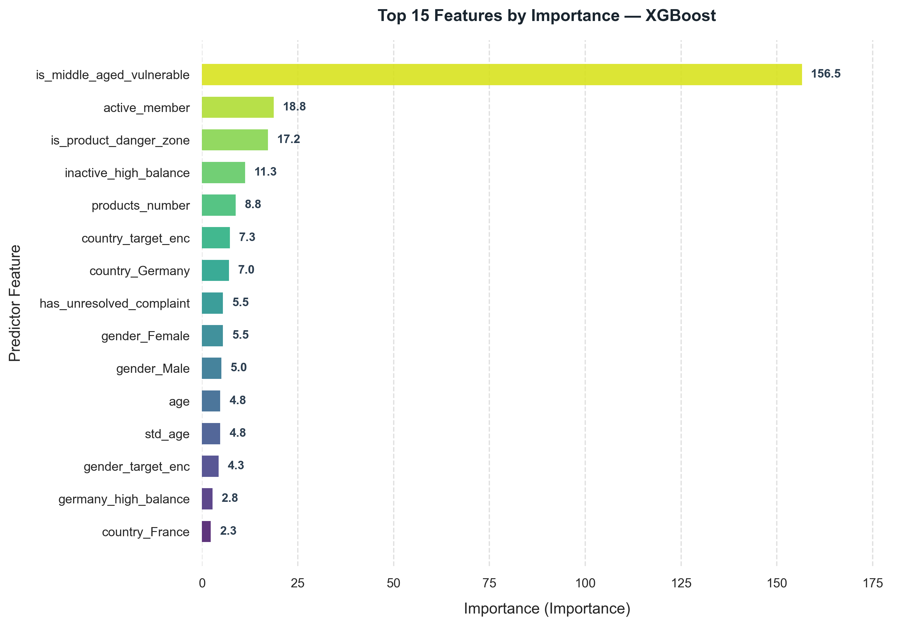
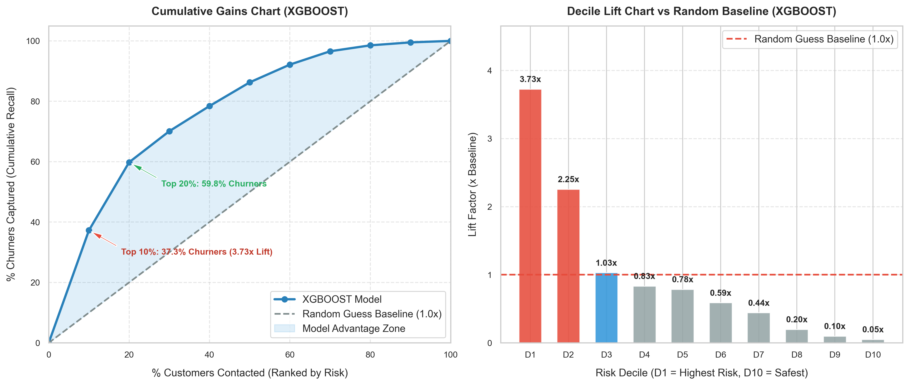

# BÁO CÁO HUẤN LUYỆN MÔ HÌNH XGBOOST (TRAINING REPORT)
## DỰ BÁO RỦI RO RỜI BỎ KHÁCH HÀNG (CUSTOMER CHURN PREDICTION)

**Thời gian huấn luyện:** `2026-11-05 00:28:18`  
**Mô hình:** `XGBoost`  
**Artifact đã lưu:** `models/saved/xgboost_churn.json`  
**Cấu hình:** [`config/config.yaml`](../config/config.yaml)  

---

## 1. KẾT QUẢ ĐÁNH GIÁ TRÊN TẬP TEST

| Metric            | Value      |
|:------------------|:-----------|
| ROC_AUC           | 0.8634     |
| PR_AUC            | 0.6754     |
| F1_Score          | 0.5484     |
| Precision         | 0.8019     |
| Recall            | 0.4167     |
| Accuracy          | 0.8600     |
| Balanced_Accuracy | 0.6951     |
| Log_Loss          | 0.6893     |
| TP                | 85         |
| FP                | 21         |
| TN                | 775        |
| FN                | 119        |
| Experiment        | Single Run |
| Model             | XGBOOST    |
| Num_Features      | 133        |
| X_val_Shape       | 1001x133   |
| SMOTE_Applied     | True       |

---

## 2. MA TRẬN NHẦM LẪN (CONFUSION MATRIX)

- **True Positives (TP - Bắt đúng khách hàng rời bỏ):** `85`
- **False Negatives (FN - Bỏ sót khách hàng rời bỏ):** `119`
- **True Negatives (TN - Nhận diện đúng khách hàng ở lại):** `775`
- **False Positives (FP - Cảnh báo nhầm khách hàng ở lại):** `21`

---

## 3. TOP 15 ĐẶC TRƯNG QUAN TRỌNG NHẤT

| Feature                   |   Importance |   Relative_Pct |
|:--------------------------|-------------:|---------------:|
| is_middle_aged_vulnerable |    156.531   |          46.32 |
| active_member             |     18.7575  |           5.55 |
| is_product_danger_zone    |     17.2359  |           5.1  |
| inactive_high_balance     |     11.2561  |           3.33 |
| products_number           |      8.81272 |           2.61 |
| country_target_enc        |      7.26132 |           2.15 |
| country_Germany           |      7.04573 |           2.09 |
| has_unresolved_complaint  |      5.49012 |           1.62 |
| gender_Female             |      5.47346 |           1.62 |
| gender_Male               |      5.02321 |           1.49 |
| age                       |      4.76559 |           1.41 |
| std_age                   |      4.7606  |           1.41 |
| gender_target_enc         |      4.32146 |           1.28 |
| germany_high_balance      |      2.75145 |           0.81 |
| country_France            |      2.30578 |           0.68 |

---

## 4. ĐÁNH GIÁ HỆ SỐ LIFT & 10 PHÂN VỊ RỦI RO (DECILE LIFT & GAINS)

### 4.1. Bảng 10 phân vị rủi ro (Decile Lift Analysis):
* **Top 10% rủi ro cao nhất (Decile D1):** Đạt hệ số **Lift 3.97x** so với chọn ngẫu nhiên.
* **Top 20% rủi ro cao nhất (Decile D1 + D2):** Đạt hệ số **Cumulative Lift 2.99x**.

| Decile   |   Customers |   Churners | Churn_Rate   | Decile_Lift   | Cum_Recall   | Cum_Lift   |
|:---------|------------:|-----------:|:-------------|:--------------|:-------------|:-----------|
| D1       |         100 |         81 | 81.00%       | 3.97x         | 39.71%       | 3.97x      |
| D2       |         100 |         41 | 41.00%       | 2.01x         | 59.80%       | 2.99x      |
| D3       |         100 |         29 | 29.00%       | 1.42x         | 74.02%       | 2.47x      |
| D4       |         100 |         14 | 14.00%       | 0.69x         | 80.88%       | 2.02x      |
| D5       |         100 |         17 | 17.00%       | 0.83x         | 89.22%       | 1.78x      |
| D6       |         100 |         11 | 11.00%       | 0.54x         | 94.61%       | 1.58x      |
| D7       |         100 |          6 | 6.00%        | 0.29x         | 97.55%       | 1.39x      |
| D8       |         100 |          4 | 4.00%        | 0.20x         | 99.51%       | 1.24x      |
| D9       |         100 |          1 | 1.00%        | 0.05x         | 100.00%      | 1.11x      |
| D10      |         100 |          0 | 0.00%        | 0.00x         | 100.00%      | 1.00x      |

### 4.2. So sánh với các Baselines & Điểm vận hành tối ưu:
| Configuration                              | Threshold   | Accuracy   | Precision   | Recall   |   F1_Score |   ROC_AUC |   PR_AUC | Precision_Lift   | Recall_Lift   | PR_AUC_Lift   |
|:-------------------------------------------|:------------|:-----------|:------------|:---------|-----------:|----------:|---------:|:-----------------|:--------------|:--------------|
| 1. Random Guess Baseline                   | -           | 67.52%     | 20.40%      | 20.40%   |     0.204  |    0.5    |   0.204  | 1.00x            | 1.00x         | 1.00x         |
| 2. Majority Class Baseline (All Non-Churn) | 1.00        | 79.60%     | 0.00%       | 0.00%    |     0      |    0.5    |   0.204  | 0.00x            | 0.00x         | 1.00x         |
| Model @ Default (0.50)                     | 0.50        | 86.00%     | 80.19%      | 41.67%   |     0.5484 |    0.8634 |   0.6754 | 3.93x            | 2.04x         | 3.31x         |
| Model @ Optimal F1                         | 0.50        | 86.00%     | 80.19%      | 41.67%   |     0.5484 |    0.8634 |   0.6754 | 3.93x            | 2.04x         | 3.31x         |
| Model @ Optimal F2 (High Recall)           | 0.05        | 20.40%     | 20.40%      | 100.00%  |     0.3389 |    0.8634 |   0.6754 | 1.00x            | 4.90x         | 3.31x         |
| Model @ Target Recall (>=75%)              | 0.05        | 20.40%     | 20.40%      | 100.00%  |     0.3389 |    0.8634 |   0.6754 | 1.00x            | 4.90x         | 3.31x         |

---
*Báo cáo được sinh tự động bởi hệ thống Digital Bank Churn Prediction Pipeline — Module 5: Model Development.*
