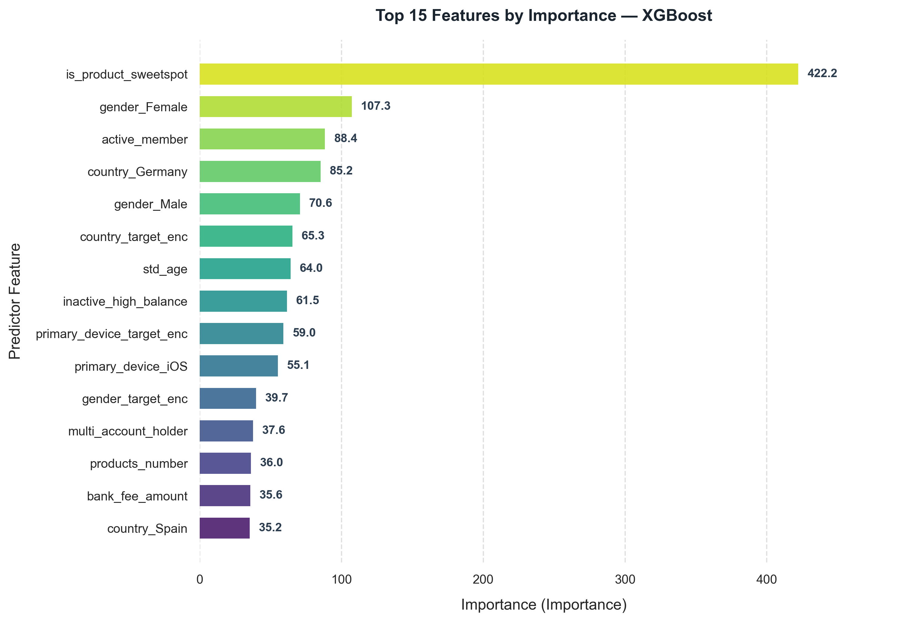

# BÁO CÁO HUẤN LUYỆN MÔ HÌNH XGBOOST (TRAINING REPORT)
## DỰ BÁO RỦI RO RỜI BỎ KHÁCH HÀNG (CUSTOMER CHURN PREDICTION)

**Thời gian huấn luyện:** `2026-10-24 00:36:06`  
**Mô hình:** `XGBoost`  
**Artifact đã lưu:** `models/saved/xgboost_churn.json`  
**Cấu hình:** [`config/config.yaml`](../config/config.yaml)  

---

## 1. KẾT QUẢ ĐÁNH GIÁ TRÊN TẬP TEST

| Metric            | Value      |
|:------------------|:-----------|
| ROC_AUC           | 0.8665     |
| PR_AUC            | 0.7056     |
| F1_Score          | 0.6194     |
| Precision         | 0.7125     |
| Recall            | 0.5479     |
| Accuracy          | 0.8630     |
| Balanced_Accuracy | 0.7457     |
| Log_Loss          | 0.3390     |
| TP                | 223        |
| FP                | 90         |
| TN                | 1503       |
| FN                | 184        |
| Experiment        | Single Run |
| Model             | XGBOOST    |
| Num_Features      | 119        |
| X_val_Shape       | 1000x119   |
| SMOTE_Applied     | True       |

---

## 2. MA TRẬN NHẦM LẪN (CONFUSION MATRIX)

- **True Positives (TP - Bắt đúng khách hàng rời bỏ):** `223`
- **False Negatives (FN - Bỏ sót khách hàng rời bỏ):** `184`
- **True Negatives (TN - Nhận diện đúng khách hàng ở lại):** `1503`
- **False Positives (FP - Cảnh báo nhầm khách hàng ở lại):** `90`

---

## 3. TOP 15 ĐẶC TRƯNG QUAN TRỌNG NHẤT

| Feature                   |   Importance |   Relative_Pct |
|:--------------------------|-------------:|---------------:|
| is_product_sweetspot      |     422.215  |          19.29 |
| gender_Female             |     107.261  |           4.9  |
| active_member             |      88.3506 |           4.04 |
| country_Germany           |      85.2093 |           3.89 |
| gender_Male               |      70.6229 |           3.23 |
| country_target_enc        |      65.3052 |           2.98 |
| std_age                   |      64.0339 |           2.93 |
| inactive_high_balance     |      61.4926 |           2.81 |
| primary_device_target_enc |      59.0274 |           2.7  |
| primary_device_iOS        |      55.1064 |           2.52 |
| gender_target_enc         |      39.7488 |           1.82 |
| multi_account_holder      |      37.6158 |           1.72 |
| products_number           |      36.0236 |           1.65 |
| bank_fee_amount           |      35.5778 |           1.63 |
| country_Spain             |      35.1586 |           1.61 |

---
*Báo cáo được sinh tự động bởi hệ thống Digital Bank Churn Prediction Pipeline — Module 5: Model Development.*
